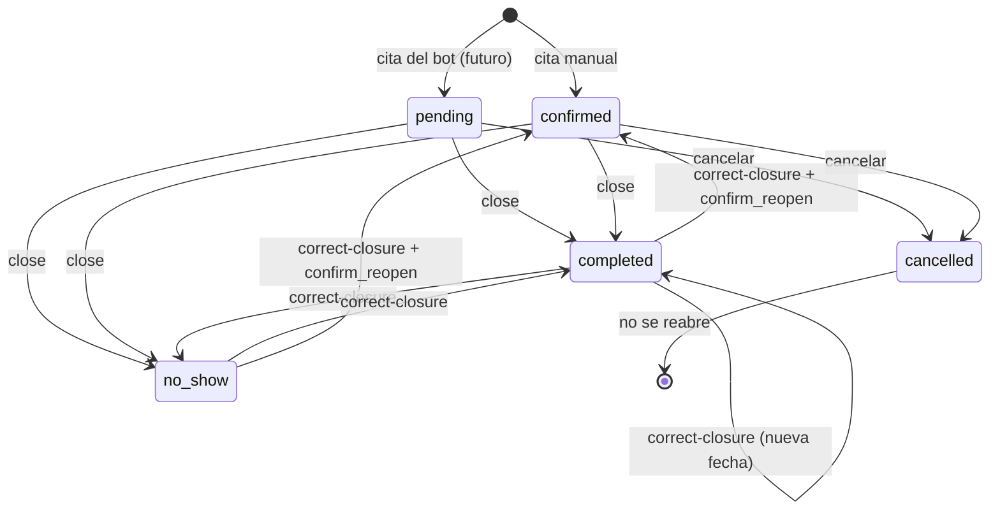

# api

Backend de Schedule App: NestJS (adaptador Express), TypeScript estricto, Kysely sobre Postgres 16. Es un proyecto independiente (su propio `package.json`).

## Requisitos

- Node 24 (`.nvmrc`).
- Docker en ejecución (para Postgres local y para las pruebas de integración).

## Configuración

```bash
cp .env.example .env
npm install
```

Variables (validadas con zod al iniciar; si falta alguna obligatoria el proceso falla):

| Variable              | Descripción                                                      |
| --------------------- | ---------------------------------------------------------------- |
| `DATABASE_URL`        | Cadena de conexión a Postgres                                    |
| `PORT`                | Puerto HTTP (por defecto 3000)                                   |
| `CORS_ORIGIN`         | Origen permitido de la PWA (por defecto `http://localhost:5173`) |
| `DEFAULT_BUSINESS_ID` | UUID del negocio por defecto hasta que exista autenticación      |

Al arrancar (`npm run start:dev` o `npm start`), `src/bootstrap.ts` carga el `.env` de la carpeta de trabajo con `src/config/load-env-file.ts`. Las variables que ya estén definidas en el entorno del proceso tienen prioridad sobre las del archivo, y si el archivo no existe se usan solo las del entorno. Si falta una variable obligatoria el proceso termina con código 1 y el mensaje indica cuál.

## Comandos

| Comando                    | Qué hace                                                         |
| -------------------------- | ---------------------------------------------------------------- |
| `npm run start:dev`        | Inicia la API en modo observación                                |
| `npm run build`            | Compila a `dist/`                                                |
| `npm test`                 | Ejecuta todas las pruebas (unidad e integración)                 |
| `npm run test:unit`        | Solo pruebas de unidad (`src/**/*.spec.ts`), no requieren Docker |
| `npm run test:integration` | Solo pruebas de integración (`*.int-spec.ts`), requieren Docker  |
| `npm run lint`             | ESLint                                                           |
| `npm run typecheck`        | `tsc --noEmit`                                                   |
| `npm run format`           | Prettier                                                         |
| `npm run openapi:export`   | Compila y reescribe `api/openapi.json` desde el código           |
| `npm run openapi:check`    | Compila y falla si `api/openapi.json` difiere del código         |

## Base de datos de desarrollo

Desde la raíz del repositorio:

```bash
docker compose up -d      # Postgres 16 con volumen con nombre `postgres_data`
docker compose ps         # el healthcheck debe pasar a `healthy`
docker compose down       # detiene el contenedor y conserva los datos
```

## Migraciones, siembra y tipos

Las migraciones usan el migrador de Kysely con SQL crudo (`up` y `down`) en `src/database/migrations/`. Kysely es solo el constructor de consultas; los `EXCLUDE`, rangos, índices parciales y triggers se escriben en SQL. La lista ordenada vive en `src/database/migrations/index.ts`.

| Comando               | Qué hace                                                                           |
| --------------------- | ---------------------------------------------------------------------------------- |
| `npm run db:migrate`  | Aplica las migraciones pendientes                                                  |
| `npm run db:rollback` | Revierte solo la última migración aplicada                                         |
| `npm run db:seed`     | Siembra el negocio con `DEFAULT_BUSINESS_ID` y zona `America/Bogota` (idempotente) |
| `npm run db:codegen`  | Regenera `src/database/db.generated.ts` desde la base migrada                      |

Los comandos leen `.env` si existe y, si no, las variables del entorno. Flujo local:

```bash
docker compose up -d --wait     # desde la raíz del repositorio
npm run db:migrate
npm run db:seed
npm run db:codegen              # solo cuando cambia el esquema; versionar el resultado
```

Para agregar una migración: crear `src/database/migrations/NNN_nombre.ts` con `up` y `down`, registrarla en `index.ts`, escribir antes la prueba de la restricción en `src/database/schema/*.int-spec.ts` y regenerar los tipos.

### Esquema

| Migración                | Contenido                                                                                           |
| ------------------------ | --------------------------------------------------------------------------------------------------- |
| `001_core_schema`        | `btree_gist`, tipo `timerange`, `businesses`, `services`, `technicians`, `availability`, `time_off` |
| `002_customers_consent`  | `customers`, `consent_events` (solo inserción) y la función `audit_rows_append_only`                |
| `003_appointments`       | `appointments` (con `appointments_no_overlap`) y `appointment_closures` (solo inserción)            |
| `004_scheduled_messages` | `scheduled_messages`, unicidad de seguimientos y trigger de consentimiento                          |
| `005_search_and_reads`   | Extensiones `unaccent` y `pg_trgm`, `immutable_unaccent` e índices de búsqueda y de citas por fecha |

La migración 005 no modifica datos. Su `down` borra los índices, la función y las extensiones en orden inverso.

- **Extensiones**: `unaccent` y `pg_trgm` vienen en los módulos `contrib` de la imagen `postgres:16-alpine` (Docker Compose y Testcontainers). Son extensiones _trusted_ desde Postgres 13: las crea el dueño de la base sin ser superusuario.
- **Permiso en un Postgres administrado**: el usuario que ejecuta `npm run db:migrate` necesita el permiso `CREATE` sobre la base de datos para ejecutar `CREATE EXTENSION`. Si el proveedor no lo concede, hay que crear las dos extensiones una vez con un rol que sí lo tenga y volver a migrar.
- **`immutable_unaccent(text)`**: envoltura `IMMUTABLE PARALLEL SAFE STRICT` de `unaccent` con el diccionario fijo `public.unaccent`. Hace falta porque `unaccent(text)` es `STABLE` y Postgres no la acepta en un índice.
- **Índices**: `ix_customers_name_search` (GIN trigram sobre `lower(immutable_unaccent(name))`), `ix_appointments_business_starts (business_id, starts_at)` e `ix_appointments_open_starts`, parcial sobre `pending` y `confirmed`.
- **`src/database/text-search.ts`**: fragmentos SQL compartidos. `normalizedContains(columna, texto)` compara sin distinguir acentos ni mayúsculas con la misma expresión del índice; `phoneDigitsContain(columna, texto)` busca los dígitos del texto (ignora espacios y guiones) y devuelve `null` si no hay dígitos; `escapeLike` trata `%`, `_` y `\` como texto literal. Es infraestructura: el dominio de `scheduling` no la importa.

Reglas que garantiza la base de datos:

- **Negocio**: `travel_buffer_min` entre 0 y 240; la zona horaria se valida al sembrar (zona IANA).
- **Aislamiento por negocio**: todas las tablas hijas llevan `business_id` y claves foráneas compuestas `(business_id, x_id)`; no se puede referenciar un registro de otro negocio.
- **Cruces**: `availability_no_overlap` y `time_off_no_overlap` (ignoran filas con `deleted_at`) y `appointments_no_overlap` sobre el bloque `[starts_at, ends_at + buffer_min)` de toda cita distinta de `cancelled`. Solo `cancelled` libera el bloque.
- **Clientes**: teléfono único por negocio, E.164 salvo anonimizados (marcador `anon-` más hexadecimales), alias único y `granted` exige `consent_at`.
- **Auditoría**: `consent_events` y `appointment_closures` rechazan `UPDATE` y `DELETE` (SQLSTATE `23000`), salvo vaciar el texto libre (`notes` y `reason`) para poder anonimizar.
- **Mensajes**: un mensaje por cita y tipo, un seguimiento pendiente por cliente y servicio, y un trigger impide filas `pending` si el cliente no está en `granted`.
- **Cierre anticipado**: `closed_early` exige `closure_reason`. Al anonimizar un cliente (fase 9) se debe usar texto neutro, no `NULL`, en esas citas.

### Errores de Postgres a errores de dominio

`DomainError` (`src/scheduling/domain/errors.ts`) lleva un `code` estable. `translatePgError` (`src/scheduling/infrastructure/persistence/pg-error-translator.ts`) convierte:

| Postgres                                    | Error de dominio       |
| ------------------------------------------- | ---------------------- |
| `23P01` sobre `appointments_no_overlap`     | `slot_taken`           |
| `23505` sobre `uq_customers_business_phone` | `customer_phone_taken` |
| `23505` sobre `uq_services_business_name`   | `service_name_taken`   |

Cualquier otro error se devuelve sin cambios; el uso previsto es `throw translatePgError(error)`.

## API HTTP

### Errores (`application/problem+json`)

El filtro global `ProblemDetailsFilter` (`src/shared/http/problem-details.filter.ts`) responde todo error como `application/problem+json` con los campos `type`, `title`, `status`, `detail` y `code`. Los errores de validación agregan `errors: [{ field, messages }]`.

| `code`                                                                                                                                                                                                          | Estado |
| --------------------------------------------------------------------------------------------------------------------------------------------------------------------------------------------------------------- | ------ |
| `validation_error`, `bad_request`                                                                                                                                                                               | 400    |
| `not_found` (incluye rutas inexistentes)                                                                                                                                                                        | 404    |
| `slot_taken`, `schedule_conflict`, `schedule_overlap`, `proposal_stale`, `customer_phone_taken`, `customer_anonymized`, `customer_has_future_appointments`, `service_name_taken`                                | 409    |
| `invalid_transition`, `slot_not_offered`, `closure_confirmation_required`, `early_closure_reason_required`, `early_closure_confirmation_required`, `reopen_confirmation_required`, `correction_reason_required` | 422    |
| `internal_error` (y cualquier `DomainError` sin estado asignado)                                                                                                                                                | 500    |

Los errores inesperados no exponen su mensaje interno; solo se registran en el log del servidor. La validación de cuerpos usa `class-validator` con `whitelist` y `forbidNonWhitelisted`: una propiedad desconocida (por ejemplo `timezone` en `PATCH /business`) se rechaza con 400.

### Negocio y servicios

`BusinessContext` resuelve siempre `DEFAULT_BUSINESS_ID` hasta que exista autenticación. Los repositorios reciben el `businessId` en cada método y filtran por él. Los campos del cuerpo y de las respuestas usan `snake_case` (como en las especificaciones) y los parámetros de consulta usan `camelCase`.

| Método y ruta         | Descripción                                                                                                         |
| --------------------- | ------------------------------------------------------------------------------------------------------------------- |
| `GET /business`       | `id`, `name`, `timezone` (solo lectura), `travel_buffer_min` y `followup_send_time` (por defecto `09:00`).          |
| `PATCH /business`     | Edita `travel_buffer_min` (entero 0 a 240) y `followup_send_time` (`HH:MM`). Cualquier otro campo se rechaza (400). |
| `GET /services`       | Servicios activos. `?includeInactive=true` suma los inactivos. Los servicios con `deleted_at` nunca se listan.      |
| `GET /services/:id`   | Un servicio (activo o inactivo); 404 si no existe o tiene `deleted_at`.                                             |
| `POST /services`      | Crea un servicio (`name`, `duration_min`, `price`, `followup_interval_days` opcional). 409 si el nombre se repite.  |
| `PATCH /services/:id` | Edita campos y reactiva o desactiva con `active`. Si cambia `duration_min`, la respuesta incluye `warning`.         |

No existe `DELETE` de servicios: se desactivan con `PATCH { "active": false }`. Editar un servicio nunca modifica las citas existentes, que conservan sus copias de precio, nombre y duración.

La advertencia de `PATCH /services/:id` es informativa y no bloquea el cambio: `warning: { code: 'future_appointments_keep_previous_duration', count }` cuando hay `count` citas futuras `pending` o `confirmed`, o `warning: null` si no las hay.

### Técnicos

| Método y ruta                       | Descripción                                                                                                   |
| ----------------------------------- | ------------------------------------------------------------------------------------------------------------- |
| `GET /technicians`                  | Técnicos del negocio, activos e inactivos. Los anonimizados se excluyen; `?includeAnonymized=true` los suma.  |
| `GET /technicians/:id`              | Un técnico (también anonimizado, con `alias` y sin `name` ni `phone`); 404 si no existe en el negocio.        |
| `POST /technicians`                 | Crea un técnico activo (`name` obligatorio, `phone` opcional).                                                |
| `PATCH /technicians/:id`            | Edita `name` y `phone` (`null` borra el teléfono). 404 si el técnico está anonimizado.                        |
| `GET /technicians/:id/availability` | Franjas semanales `{ id, weekday (1 a 7, ISO), start_time, end_time }` en hora local `HH:MM`, por día y hora. |
| `GET /technicians/:id/time-off`     | Días libres `{ id, starts_at, ends_at, reason }` con instantes ISO 8601 UTC, por fecha de inicio.             |

`active`, la disponibilidad y los días libres son de solo lectura en estos endpoints: un `PATCH` que incluya `active` (o cualquier campo no declarado) responde 400 `validation_error`. Se escriben únicamente por el flujo de cambios de horario (ver "Cambios de horario y eliminación de técnicos"), que valida las citas afectadas. Las pruebas preparan técnicos, franjas, días libres y citas con las fábricas de `test/support/factories.ts`.

Las rutas de escritura de horario viven en `ScheduleChangesController` (`scheduling/infrastructure/http`) bajo el mismo prefijo `/technicians`:

| Método y ruta                                    | Descripción                                                                                                    |
| ------------------------------------------------ | -------------------------------------------------------------------------------------------------------------- |
| `POST /technicians/:id/schedule-changes/preview` | Solo lectura: citas afectadas por un cambio y propuesta de reasignación (200).                                 |
| `POST /technicians/:id/schedule-changes`         | Aplica un cambio (200): día libre, quitar día libre, reemplazar disponibilidad, desactivar o reactivar.        |
| `DELETE /technicians/:id`                        | Elimina al técnico por anonimización (200). Mismo flujo con `change = erase`; cuerpo opcional `reassignments`. |

### Transacciones por negocio

`TransactionRunner.run(businessId, work)` abre una transacción `READ COMMITTED` y fija `app.business_id` solo para esa transacción (`set_config(..., true)`, equivalente a `SET LOCAL`). Hoy no hay Row Level Security; la variable deja lista esa política como una migración aislada.

## Dominio de agendamiento

`src/scheduling/domain/` contiene funciones puras de TypeScript, sin Nest, Kysely ni Postgres (una prueba lo verifica). Los instantes son milisegundos desde la época Unix y los rangos son semiabiertos `[start, end)`.

| Archivo                               | Responsabilidad                                                                                                                                                                                                       |
| ------------------------------------- | --------------------------------------------------------------------------------------------------------------------------------------------------------------------------------------------------------------------- |
| `time/zoned-clock.ts`                 | Único lugar donde se convierte fecha y hora locales de una zona IANA a instantes (Luxon). Hora inexistente avanza; hora ambigua toma la primera ocurrencia.                                                           |
| `services/generate-slots.ts`          | `generateSlots`: cupos adaptativos por técnico y franja, agrupados por inicio. Recibe los bloques ocupados ya calculados.                                                                                             |
| `services/occupied-blocks.ts`         | Bloque ocupado de una cita `[starts_at, ends_at + buffer_min)`. Solo `cancelled` lo libera. `excludeAppointmentId` libera el bloque propio al mover.                                                                  |
| `services/assign-technician.ts`       | `assignTechnician`: técnico preferido si está libre; si no, el de menos minutos agendados. Devuelve `null` si no hay técnicos libres.                                                                                 |
| `services/technician-load.ts`         | Minutos de servicio por técnico en un día local (sin buffer, sin canceladas).                                                                                                                                         |
| `services/appointment-status.ts`      | Máquina de estados de la cita (D11) y `invalid_transition`.                                                                                                                                                           |
| `services/appointment-closure.ts`     | `planClosure` (cierre normal y anticipado) y `planCorrection` (corrección, fecha de completado y reapertura): estado nuevo, fila de auditoría y efecto sobre el seguimiento.                                          |
| `services/book-slot.ts`               | `bookSlot`: técnico que atiende una hora pedida, o `slot_taken` / `slot_not_offered` si no se puede. Acepta un técnico pedido (restringe) o preferido (prioridad).                                                    |
| `services/technician-availability.ts` | `isTechnicianFree`: el técnico trabaja en un horario exacto y su bloque ocupado no choca con el de la cita (reasignación manual).                                                                                     |
| `services/working-day.ts`             | `workingRangesOn`: tramos (instantes) en los que un técnico trabaja un día local: sus franjas de ese día de la semana menos los días libres, completos o parciales. Vacío si no hay franjas o todas quedan cubiertas. |
| `services/schedule-change.ts`         | `findAffectedAppointments`: citas `pending`/`confirmed` desde `now` que un `ScheduleChange` (modelo en `model/schedule-change.ts`) deja sin cobertura.                                                                |
| `services/plan-reassignments.ts`      | `planReassignments` (propuesta cronológica con carga y ocupación en memoria) y `findUnavailableTargets` (verifica los destinos al aplicar).                                                                           |
| `services/availability-windows.ts`    | `validateAvailabilityWindows`: día 1 a 7, horas `HH:MM` hasta 23:59, fin posterior al inicio y sin solapes por día.                                                                                                   |
| `services/alias.ts`                   | `generateAlias`: alias aleatorio `palabra_número` que no esté ya usado en el negocio. Listas de palabras de técnicos (`tiger_1`) y de clientes (`bear_1`).                                                            |
| `services/followup-policy.ts`         | `followupSendAt` (fecha local de cierre más intervalo, a la hora de envío del negocio), `canScheduleFollowups`, `planCompletionFollowup` (al completar) y `selectBackfillFollowups` (consentimiento tardío).          |
| `services/customer-anonymization.ts`  | `anonymizedPhone` (`anon-` más 26 hexadecimales, nunca un E.164), `isAnonymizedPhone` y el texto neutro que reemplaza motivos libres.                                                                                 |
| `model/consent.ts`                    | Tipos de consentimiento: estado, tipo de evento y medio (`in_person`, `phone_call`, `whatsapp`, `written`, `other`).                                                                                                  |
| `ports/`                              | Interfaces de persistencia (`AppointmentRepository`, `ScheduleReader`, `CustomerDirectory`, `ConsentRepository`, `FollowupRepository`) y `CommandExecutor`. Solo tipos.                                               |

Reglas de `generateSlots`:

- El primer cupo de cada franja empieza al inicio de la franja; el siguiente, al terminar el bloque anterior (servicio más buffer).
- El servicio debe caber completo en la franja y no cruzar un día libre. El buffer final puede salirse de la franja o invadir un día libre, pero no cruzar la cita siguiente.
- Los cupos anteriores a `now` se omiten sin mover la cadena; un cupo que empieza exactamente en `now` se ofrece.
- `SlotCandidate.technicianIds` lista a los técnicos libres en ese inicio, ordenados por antigüedad (`createdAt`, luego `id`). `assignTechnician` desempata por esa posición.
- Las franjas se convierten a instantes reales: en el retroceso de otoño una franja `00:00-03:00` dura cuatro horas reales y cada instante se ofrece una sola vez.

## Cupos y citas

Estructura hexagonal de `src/scheduling/`: `domain/` (funciones puras y puertos), `application/` (casos de uso sin Nest: `ListSlots`, `CreateAppointment`, `CancelAppointment`, `CloseAppointment`, `CorrectClosure`, `MoveAppointment`, `ReassignAppointment`, `ListFreeTechnicians`, `PreviewScheduleChange`, `ApplyScheduleChange`, `QueryAppointments`, `loadDaySchedule` y `appointmentFit`), `infrastructure/` (adaptadores de Kysely, controladores, DTO) y `scheduling.module.ts`, que cablea todo con los tokens de `application/tokens.ts` (`CLOCK`, `COMMAND_EXECUTOR`, `READ_PORTS`). Las pruebas fijan el reloj con `createTestApp({ now })`.

### Ejecutor de comandos y bloqueo del negocio

`BusinessLockExecutor` (`infrastructure/persistence/business-lock-executor.ts`) ejecuta cada comando de agenda en una transacción `READ COMMITTED` que empieza con `SELECT id FROM businesses WHERE id = $1 FOR UPDATE`. Dos comandos del mismo negocio se serializan; negocios distintos no se bloquean entre sí. Si el comando falla, la transacción se revierte y el bloqueo se libera. `appointments_no_overlap` sigue siendo la última defensa: aun sin el bloqueo, una colisión falla con `23P01` y se traduce a `slot_taken`. El bloqueo evita además el falso conflicto entre dos solicitudes automáticas que elegirían al mismo técnico libre.

### Endpoints

| Método y ruta                            | Descripción                                                                                                                                                                                                         |
| ---------------------------------------- | ------------------------------------------------------------------------------------------------------------------------------------------------------------------------------------------------------------------- |
| `GET /slots`                             | Cupos de un servicio. Consulta: `serviceId`, `from` (`AAAA-MM-DD`, día local), `days` (1 a 31, por defecto 1), `excludeAppointmentId` y `preferredTechnicianId` opcionales. Responde `{ slots, has_availability }`. |
| `POST /appointments`                     | Crea una cita `confirmed` (201). Cuerpo: `customer_id`, `service_id`, `starts_at` (ISO 8601 con zona), `address` (obligatoria) y `technician_id` opcional.                                                          |
| `POST /appointments/:id/cancel`          | Cancela una cita `pending` o `confirmed` (200). Cuerpo opcional: `reason`. Libera el bloque y anula sus mensajes programados pendientes.                                                                            |
| `POST /appointments/:id/close`           | Cierra una cita `pending` o `confirmed` como `completed` o `no_show` (200). Cuerpo: `outcome`, `confirm`, y para el cierre anticipado `reason` y `confirm_early`. Ver "Cierre, corrección y seguimiento".           |
| `POST /appointments/:id/correct-closure` | Corrige el cierre de una cita `completed` o `no_show` (200): cambia de resultado, corrige la fecha de completado o la reabre. Cuerpo: `outcome`, `reason`, `confirm_reopen`, `completed_at`.                        |
| `POST /appointments/:id/move`            | Mueve una cita `pending` o `confirmed` a un cupo generado (200). Cuerpo: `starts_at` (ISO 8601 con zona). Ver "Mover y reasignar".                                                                                  |
| `POST /appointments/:id/reassign`        | Cambia solo el técnico de una cita `pending` o `confirmed` (200). Cuerpo: `technician_id`. Ver "Mover y reasignar".                                                                                                 |
| `GET /appointments`                      | Citas de cualquier estado con técnico, cliente y servicio. Consulta: `from` y `to` (días locales, ambos incluidos, hasta 62 días), ordenadas por inicio.                                                            |
| `GET /appointments/:id`                  | Detalle de una cita (404 si no existe en el negocio).                                                                                                                                                               |
| `GET /appointments/:id/free-technicians` | Técnicos libres en el horario exacto de una cita `pending` o `confirmed` (200, `[{ id, name }]`). Solo lectura. Ver "Técnicos libres para una cita".                                                                |
| `GET /agenda/visible-hours`              | Horas de trabajo por día para la grilla (200, `{ days: [{ date, start_minute, end_minute }] }`). Consulta: `from`, `to` y `technicianIds` repetido. Solo lectura. Ver "Horas visibles de la agenda".                |
| `GET /agenda/to-close`                   | Servicios `confirmed` con inicio pasado y sin cerrar (200, `{ items, total }`, hasta 200 por antigüedad). Solo lectura. Ver "Resumen del Panel de control y servicios por cerrar".                                  |
| `GET /dashboard/summary`                 | Tarjetas y lista "Servicios de hoy" del Panel (200). Solo lectura. Ver "Resumen del Panel de control y servicios por cerrar".                                                                                       |

Cada cupo de `GET /slots` es `{ starts_at, ends_at, occupied_until, technician_id, available_technician_ids }`: un inicio aparece una sola vez con el técnico asignado, y `available_technician_ids` (por antigüedad) alimenta la reasignación manual. Sin técnicos, con un servicio inactivo o sin huecos, `slots` es `[]` y `has_availability` es `false`. Los instantes se devuelven en ISO 8601 UTC.

Duración al mover: con `excludeAppointmentId`, `GET /slots` dimensiona los cupos con la duración de esa cita (`ends_at - starts_at`), igual que `POST /appointments/:id/move`, y no con la actual del servicio, que pudo cambiar desde que se creó la cita. Así el diálogo de mover nunca ofrece un cupo que mover rechace con `slot_not_offered`. El buffer es el vigente del negocio en ambos casos. Si la cita indicada no existe en el negocio, se usa la duración del servicio.

Con `excludeAppointmentId` (mover una cita) su bloque y su carga no cuentan: `loadDaySchedule` retira la cita antes de calcular ocupación y minutos agendados, porque `bookedMinutesByTechnician` del dominio no conoce ese parámetro. `MoveAppointment` y `ReassignAppointment` usan esa misma función y no calculan la carga por su cuenta; `day-schedule.spec.ts` verifica que los minutos de la cita movida no se cuentan a nadie. Como el técnico actual tiene prioridad cuando está libre, esta exclusión solo cambia el resultado cuando se consultan cupos sin `preferredTechnicianId`.

### Flujo de `POST /appointments`

```
BEGIN (READ COMMITTED); SELECT ... FROM businesses WHERE id = $1 FOR UPDATE
  leer zona horaria y buffer del negocio, servicio y cliente  (404 si no existen)
  servicio inactivo                                         -> slot_not_offered (422)
  cargar técnicos reservables, días libres y bloques ocupados del día local
  bookSlot: regenerar los cupos del día con la agenda ya confirmada
    la hora es un cupo y hay técnico libre                   -> asignar (menos cargado; técnico pedido si está libre)
    no es un cupo y choca con el bloque de una cita          -> slot_taken (409)
    cualquier otro caso                                      -> slot_not_offered (422)
  INSERT appointments (confirmed, snapshots, buffer_min, slot = [inicio, fin + buffer))
  UPDATE customers SET address = <dirección usada> si cambió
COMMIT
```

La colisión se evalúa antes que la pertenencia a la grilla. "Choca" significa que todos los técnicos relevantes (los que trabajan a esa hora o tienen un bloque que se solapa) tienen una cita no cancelada encima; con `technician_id` solo cuenta ese técnico. El bloque de `completed`, `no_show` y las citas cerradas antes de tiempo se conserva; solo `cancelled` lo libera. La dirección se copia en `address_snapshot` y la última dirección usada reemplaza a `customers.address`; el precio, el nombre del servicio y el buffer también se copian y no cambian con ediciones posteriores.

### Mover y reasignar

Ambos comandos corren bajo el mismo bloqueo del negocio que la creación. Solo aplican a citas `pending` o `confirmed`; una `completed` o `no_show` debe reabrirse antes y una `cancelled` no se reabre. Los dos responden `invalid_transition` (422) y no modifican la cita.

**`POST /appointments/:id/move`**

```
BEGIN; SELECT ... FROM businesses WHERE id = $1 FOR UPDATE
  leer la cita (404) y exigir pending|confirmed                -> invalid_transition (422)
  cargar el día destino sin el bloque ni la carga de la cita   (excludeAppointmentId)
  bookSlot con el técnico actual como preferido                -> el mismo flujo que crear
    la hora es un cupo: gana el técnico actual si está libre; si no, el menos cargado
    no es un cupo y choca con una cita                          -> slot_taken (409)
    cualquier otro caso                                         -> slot_not_offered (422)
  UPDATE appointments SET technician_id, starts_at, ends_at, buffer_min, slot
         [, technician_changed = true si el técnico cambió]
COMMIT
```

- Se ofrecen cupos de todos los técnicos. La cita no choca con su propio bloque anterior, así que un cupo que lo solapa (por ejemplo 09:15 para una cita de 10:00 con buffer 15) es válido.
- La duración sale de la propia cita, no del servicio, que pudo cambiar después de crearla. Servicio, dirección y precio se conservan. Solo `buffer_min` se toma de nuevo del negocio (D1), y con él se recalcula el bloque.
- `technician_changed` pasa a `true` cuando cambia el técnico. Si no cambia, la marca queda como estaba: mover no la borra. Esta marca servirá para que el mensaje de reprogramación del bot mencione el cambio; en este sprint no se envía nada.
- Si otra solicitud ocupó el cupo entre listarlo y confirmar, la respuesta es `slot_taken` y la cita conserva su horario. La actualización es una sola sentencia: no existe un estado intermedio sin bloque.
- La especificación no dice qué pasa con los mensajes programados de una cita movida, así que no se tocan.
- Mover una cita cuyo servicio se desactivó después sí se permite: la desactivación solo evita citas nuevas.

**`POST /appointments/:id/reassign`**

- Cambia solo el técnico; la hora no cambia y la cita queda con `technician_changed = true`.
- El destino debe ser un técnico activo y no anonimizado, trabajar en ese horario exacto (franja semanal que contiene el servicio, sin día libre encima) y no tener un bloque ocupado que se solape con el de la cita, buffer incluido. No se exige que la hora pertenezca a su grilla de cupos.
- Un destino que existe pero no cumple (ocupado, sin franja ese día u hora, con día libre, inactivo o anonimizado) responde `slot_taken` (409) y la cita no cambia. Un técnico que no existe en el negocio responde `not_found`.
- Reasignar al técnico que ya tiene la cita responde 200 sin cambios y sin marcar `technician_changed`.
- Este endpoint también sirve para resolver a mano las citas sin reemplazo de una propuesta de reasignación (fase 8).

### Técnicos libres para una cita

`GET /appointments/:id/free-technicians` responde `[{ id, name }]` con los técnicos que `POST /appointments/:id/reassign` aceptaría como destino, ordenados por antigüedad (`created_at`, luego `id`). Alimenta el diálogo de reasignar.

- **Regla de "libre".** Es la de `isTechnicianFree`, la misma que usa reasignar: el técnico es activo y no está anonimizado, una franja semanal contiene el servicio completo, ningún día libre (completo o parcial) se solapa con el servicio y ningún bloque ajeno se solapa con el bloque de la cita (servicio más su buffer congelado). Todo estado distinto de `cancelled` conserva su bloque, incluidos `completed` y `no_show`. El bloque de la propia cita se ignora (`loadDaySchedule` con `excludeAppointmentId`).
- **Técnico actual.** No se ofrece. Reasignar a él es una operación sin efecto.
- **Errores.** Una cita inexistente o de otro negocio responde `not_found` (404). Una cita `cancelled`, `completed` o `no_show` responde `invalid_transition` (422), igual que reasignar. No hay códigos nuevos.
- **Sin bloqueo.** `ListFreeTechnicians` lee con `READ_PORTS` y no toma el bloqueo del negocio: la lista es una foto del momento. Si otro cliente ocupa al técnico elegido antes de confirmar, `POST /appointments/:id/reassign` responde `slot_taken` (409) y el diálogo debe volver a pedir la lista.
- **Paridad.** `appointment-fit.ts` arma el `AppointmentFit` (inicio, duración real y buffer congelado) para los dos casos de uso. `free-technicians.http.int-spec.ts` recorre técnicos ocupados, fuera de turno, con día libre, con buffer, con vecinos `completed`, `no_show` y `cancelled`, desactivados y eliminados, y comprueba que el conjunto devuelto es exactamente aquel para el que reasignar responde 200.

### Horas visibles de la agenda

`GET /agenda/visible-hours?from=YYYY-MM-DD&to=YYYY-MM-DD&technicianIds=<uuid>&technicianIds=<uuid>` responde `{ days: [{ date, start_minute, end_minute }] }` con un registro por día local del rango. La grilla de escritorio lo usa para elegir sus horas con una sola solicitud en lugar de una por técnico.

- **Cálculo.** Para cada día, `visibleMinutesOn` toma `workingRangesOn` (disponibilidad semanal menos días libres) de los técnicos pedidos y devuelve el menor inicio y el mayor fin, en minutos de pared desde la medianoche local del negocio (0 a 1440). `minuteOfDay` vive en `zoned-clock.ts`, el único archivo del dominio que importa Luxon. Un tramo que llega a la medianoche del día siguiente vale 1440. En los días de 23 y 25 horas cuenta la hora de pared, no las horas transcurridas.
- **Día sin trabajo.** Si ninguno de los técnicos pedidos trabaja ese día (sin franja, o con días libres que cubren todas), `start_minute` y `end_minute` son `null`. La interfaz redondea el inicio hacia abajo y el fin hacia arriba a horas completas, amplía el rango para incluir los servicios visibles y usa 07:00-19:00 cuando todos los días son `null`.
- **Validación.** `from` y `to` son fechas locales válidas, ambas incluidas, con `from <= to` y hasta 62 días. `technicianIds` es opcional, admite hasta 10 UUID y acepta ids repetidos. Cualquier incumplimiento responde `validation_error` (400). Sin `technicianIds` todos los días salen en `null`.
- **Aislamiento.** Solo cuentan técnicos activos y no anonimizados del negocio de la sesión (`listBookableTechnicians`). Los ids desconocidos, de otro negocio, desactivados o anonimizados se ignoran sin error y no revelan si existen.
- **Solo lectura.** `GetVisibleHours` lee con `READ_PORTS`, sin bloqueo del negocio y sin escribir. No hay códigos de error nuevos.

### Resumen del Panel de control y servicios por cerrar

`GET /dashboard/summary` (sin parámetros) responde, para "ahora" en la zona del negocio:

```json
{
  "today": "2026-10-24",
  "services_today": 4,
  "active_technicians": { "working": 2, "total": 3 },
  "efficiency": { "rate": 0.2, "completed": 1, "due": 5, "from": "2026-09-25" },
  "pending_to_close": 2,
  "remaining_today": [
    {
      "id": "…",
      "status": "confirmed",
      "starts_at": "…",
      "ends_at": "…",
      "customer": {},
      "service": {},
      "technician": {}
    }
  ]
}
```

`GET /agenda/to-close` responde `{ items: Appointment[], total }`. Ambas rutas son de solo lectura, filtran por el negocio de la sesión y no agregan códigos de error.

- **Hoy y ventana.** `today` es el día local del negocio (`localDateOf` con `CLOCK`), de 00:00 a 24:00 local aunque dure 23 o 25 horas. La ventana de eficiencia son 30 días calendario locales que incluyen hoy: `[00:00 local de hoy - 29 días, ahora)`. No se resta 720 horas, de modo que el cambio de horario no la desplaza. `efficiency.from` es la fecha de corte (2026-09-25 si hoy es 2026-10-24) y `today` evita que la interfaz use el reloj del navegador.
- **Servicios hoy.** Servicios de hoy en cualquier estado salvo `cancelled` (`servicesToday`).
- **Técnicos activos X/Y.** Y son los técnicos activos y no anonimizados. X son los que tienen turno hoy (`workingRangesOn` no vacío): la disponibilidad semanal cubre el día de la semana y ningún día libre cubre todo su turno. Un día libre igual o mayor que el turno lo saca de X; uno parcial no; sin disponibilidad hoy no cuenta en X.
- **Eficiencia.** `completed / due`, con `due` igual a los servicios no cancelados de la ventana cuyo inicio ya pasó (incluye `no_show` y los sin cerrar). `rate` es una fracción de 0 a 1, o `null` si `due` es 0; la interfaz redondea el porcentaje y muestra "Sin datos".
- **Pendientes y por cerrar.** Solo `confirmed` con inicio anterior a ahora y sin cerrar, de cualquier fecha (`TO_CLOSE_STATUSES`); `pending` no cuenta. La tarjeta (`pending_to_close`) cuenta todos y `to-close` devuelve los 200 más antiguos primero con `total` igual a ese conteo. Un servicio que empezó hace un minuto ya cuenta.
- **Lista de hoy.** `remaining_today` son los `pending` y `confirmed` de hoy (iniciados sin cerrar y por empezar), por inicio y luego por nombre del técnico. Cada fila trae solo hora, estado, cliente, servicio y técnico: sin teléfono, dirección ni notas. Hasta la fase 5 un cliente anonimizado aparece con su alias como nombre.
- **Capas.** Las reglas son funciones puras en `dashboard-kpis.ts` y los límites de tiempo salen de `zoned-clock`. El puerto `AgendaReadModel` (token `AGENDA_READ_MODEL`, fuera de `SchedulingPorts`) solo cuenta por estado y rango; `AppointmentRepository.listStartedBefore` devuelve la lista acotada y el total.

### Códigos de error del flujo

| Código                | Estado | Cuándo                                                                                                                         |
| --------------------- | ------ | ------------------------------------------------------------------------------------------------------------------------------ |
| `validation_error`    | 400    | Dirección ausente o vacía, UUID o fecha inválidos, `starts_at` sin zona, rango de agenda inválido.                             |
| `not_found`           | 404    | Cliente, servicio, cita o técnico de la ruta inexistente en el negocio.                                                        |
| `slot_taken`          | 409    | La hora pedida choca con el bloque (duración más buffer) de una cita no cancelada, incluida una concurrente.                   |
| `customer_anonymized` | 409    | `POST /appointments` para un cliente anonimizado; la cita no se crea.                                                          |
| `slot_not_offered`    | 422    | La hora no es un cupo generado y no choca con ninguna cita; también servicio o técnico pedido no reservable.                   |
| `invalid_transition`  | 422    | Cancelar, mover o reasignar una cita `cancelled`, `completed` o `no_show`. Una cancelada no se reabre: se crea una cita nueva. |

## Cierre, corrección y seguimiento

Cerrar una cita es siempre una acción explícita del dueño con confirmación: nada se cierra por el paso del tiempo. Los tres comandos corren bajo el bloqueo del negocio, en una sola transacción: el cambio de la cita, la fila de `appointment_closures` y el efecto sobre el seguimiento se guardan juntos o no se guarda nada. El actor es el dueño fijo (`owner`) mientras no exista autenticación. Una cita cerrada conserva su bloque de tiempo (solo `cancelled` lo libera), incluso si se cerró antes de su hora, y la corrección o la reapertura nunca lo modifican.

### Máquina de estados (D11)



Cualquier otra transición responde `invalid_transition` (422). Una cita `cancelled` nunca sale de ese estado: el mensaje indica crear una cita nueva. Mover, reasignar y cancelar solo aplican a `pending|confirmed`, así que una cita cerrada debe reabrirse antes.

### `POST /appointments/:id/close`

Cuerpo (`snake_case`): `outcome` (`completed` o `no_show`), `confirm`, `reason` (opcional, hasta 500 caracteres) y `confirm_early`. Responde la cita (200).

| Situación                                         | Requisitos                                                                    | Error si falta                                                                     |
| ------------------------------------------------- | ----------------------------------------------------------------------------- | ---------------------------------------------------------------------------------- |
| Cierre normal (`now` igual o posterior al inicio) | `confirm: true`. El `reason` es opcional y solo se audita.                    | `closure_confirmation_required` (422)                                              |
| Cierre anticipado (`now` anterior al inicio)      | `reason` con texto y `confirm_early: true`. `confirm` no basta ni hace falta. | `early_closure_reason_required`, luego `early_closure_confirmation_required` (422) |
| Cita ya `completed`, `no_show` o `cancelled`      | -                                                                             | `invalid_transition` (422)                                                         |

- Completar guarda `completed_at` y `closed_at` con el instante actual; no asistió guarda solo `closed_at`. El cierre anticipado marca `closed_early = true` y copia el motivo en `closure_reason`; el cierre normal deja `closure_reason` en nulo.
- Escribe una fila de `appointment_closures` con `outcome`, `previous_outcome` (`pending` o `confirmed`), `early`, `reason`, las fechas de completado y el actor.

### `POST /appointments/:id/correct-closure`

Cuerpo (`snake_case`): `outcome` (`completed`, `no_show` o `confirmed`), `reason`, `confirm_reopen` y `completed_at` (ISO 8601 con zona). Solo aplica a citas `completed` o `no_show`; una `pending|confirmed` responde `invalid_transition` porque aún no está cerrada. Toda corrección exige `reason` (`correction_reason_required`, 422) y queda auditada con quién, cuándo y por qué.

| Corrección                                      | `outcome` y datos                                        | Cita                                                                                        | Seguimiento                                                              | `appointment_closures.outcome` |
| ----------------------------------------------- | -------------------------------------------------------- | ------------------------------------------------------------------------------------------- | ------------------------------------------------------------------------ | ------------------------------ |
| `completed` a `no_show`                         | `no_show`                                                | Limpia `completed_at`; conserva `closed_at`, `closed_early` y `closure_reason`.             | Anula el pendiente: `cancel_reason = 'closure_corrected'`.               | `no_show`                      |
| `no_show` a `completed`                         | `completed`, `completed_at` opcional (por defecto ahora) | Fija `completed_at`.                                                                        | Aplica la regla de seguimiento al completar.                             | `completed`                    |
| Fecha de completado                             | `completed` y `completed_at` obligatoria                 | Cambia `completed_at`.                                                                      | Recalcula `send_at` del pendiente de la cita; no crea ni reactiva filas. | `completion_date_corrected`    |
| Reapertura (`completed\|no_show` a `confirmed`) | `confirmed`, `confirm_reopen: true`, `reason`            | Limpia `completed_at`, `closed_at`, `closed_early` y `closure_reason`; el bloque no cambia. | Anula el pendiente: `cancel_reason = 'reopened'`.                        | `reopened`                     |

- Sin `confirm_reopen: true` la reapertura responde 422 `reopen_confirmation_required` y la cita no cambia. Esa bandera se revisa antes que el motivo.
- `completed_at` solo se admite al corregir a `completed`, no puede ser futura y debe llevar zona horaria. La fecha de completado de una cita ya `completed` es obligatoria; si falta o es inválida responde `validation_error` (400).
- Las filas de seguimiento `sent` o `failed` nunca se modifican.

### Seguimiento al completar

`scheduleCompletionFollowup` (`application/completion-followup.ts`) se invoca con la cita ya guardada como `completed`, de modo que no cuenta como su propia "cita futura". `planCompletionFollowup` decide:

1. El cliente tiene consentimiento `granted` (si no, no hay fila: CR-R6).
2. El servicio tiene `followup_interval_days`.
3. El cliente no tiene otra cita `pending|confirmed` de ese servicio que empiece ahora o después.

Si se cumplen, `send_at` es la fecha local del negocio de `completed_at` más el intervalo, a las `followup_send_time` del negocio (09:00 por defecto): completar el 2026-11-01 con 180 días da 2027-04-30 09:00 hora de Bogotá, y 2026-11-05 con 90 días da 2027-02-03. `FollowupRepository.replacePending` anula como `superseded` el seguimiento `pending` del mismo cliente y servicio que pertenezca a otra cita y deja la cita con su fila `pending`. Una cita tiene a lo sumo una fila (`UNIQUE (appointment_id, kind)`): si ya tenía una `cancelled` o `pending`, se reutiliza con la nueva fecha; así, cerrar, reabrir y volver a cerrar no duplica filas. Si la regla no procede, no se toca nada, tampoco el seguimiento pendiente de otras citas. `no_show` nunca crea seguimiento. Este sprint no envía mensajes: los seguimientos son solo filas en `scheduled_messages`.

`replacePending` es distinto de `FollowupRepository.schedule` (relleno por consentimiento tardío), que solo reactiva filas canceladas por `consent_revoked`.

### Códigos de error del cierre

| Código                                | Estado | Cuándo                                                                                           |
| ------------------------------------- | ------ | ------------------------------------------------------------------------------------------------ |
| `closure_confirmation_required`       | 422    | Cierre normal sin `confirm: true`.                                                               |
| `early_closure_reason_required`       | 422    | Cierre anticipado sin motivo (vacío o solo espacios).                                            |
| `early_closure_confirmation_required` | 422    | Cierre anticipado sin `confirm_early: true`.                                                     |
| `reopen_confirmation_required`        | 422    | Devolver una cita cerrada a `confirmed` sin `confirm_reopen: true`.                              |
| `correction_reason_required`          | 422    | Corrección o reapertura sin motivo.                                                              |
| `invalid_transition`                  | 422    | Cerrar una cita ya cerrada o cancelada; corregir una cita cancelada o aún abierta.               |
| `validation_error`                    | 400    | Cuerpo inválido; fecha de completado futura, ausente al corregirla o enviada con otro `outcome`. |
| `not_found`                           | 404    | La cita no existe en el negocio.                                                                 |

## Cambios de horario y eliminación de técnicos

Toda escritura de disponibilidad, días libres o `active` de un técnico, y su eliminación, pasa por `ApplyScheduleChange`. `PreviewScheduleChange` calcula lo mismo sin escribir. Los dos comparten `evaluateScheduleChange` (`application/schedule-change-evaluation.ts`).

### Cambios admitidos

Cuerpo de ambos `POST` (`snake_case`): `{ "change": { ... }, "reassignments": [{ "appointment_id", "technician_id" }] }`. La vista previa solo recibe `change`.

| `change.type`          | Campos                                                                               | Cita afectada                                                               |
| ---------------------- | ------------------------------------------------------------------------------------ | --------------------------------------------------------------------------- |
| `add_time_off`         | `starts_at`, `ends_at` (ISO 8601 con zona, fin posterior al inicio), `reason`        | El servicio de la cita (sin buffer) se solapa con el período.               |
| `remove_time_off`      | `time_off_id`                                                                        | Ninguna. Es baja lógica (`deleted_at`); 404 si no existe o ya se quitó.     |
| `replace_availability` | `windows: [{ weekday (1 a 7), start_time, end_time }]` (reemplaza todas las franjas) | El servicio no cabe completo en una franja nueva (el buffer puede salirse). |
| `deactivate`           | ninguno                                                                              | Toda cita activa futura.                                                    |
| `activate`             | ninguno                                                                              | Ninguna. No necesita `reassignments`.                                       |
| `erase`                | ninguno (solo por `DELETE /technicians/:id` y en la vista previa)                    | Toda cita activa futura.                                                    |

Una cita afectada es `pending` o `confirmed` con `starts_at >= now`. Los campos que no corresponden al `type` se rechazan con 400. Un técnico inexistente, de otro negocio o ya anonimizado responde 404 en todos los casos, incluida una segunda eliminación.

### Flujo

```mermaid
sequenceDiagram
  participant UI as app
  participant C as ScheduleChangesController
  participant P as PreviewScheduleChange
  participant A as ApplyScheduleChange
  participant DB as Postgres
  UI->>C: POST /technicians/:id/schedule-changes/preview {change}
  C->>P: execute (solo lectura, sin bloqueo)
  P->>DB: citas activas futuras, técnicos reservables y su ocupación
  P-->>UI: {affected[], proposal[], fully_resolvable}
  UI->>C: POST /technicians/:id/schedule-changes {change, reassignments[]}
  C->>A: execute
  A->>DB: BEGIN; SELECT ... FROM businesses FOR UPDATE
  A->>A: recalcular afectadas
  alt hay afectadas y reassignments vacío
    A-->>UI: 409 schedule_conflict {affected, proposal, fully_resolvable}
  else las citas reasignadas no son exactamente las afectadas
    A-->>UI: 409 proposal_stale {affected, proposal, fully_resolvable}
  else un destino no puede atender su cita
    A-->>UI: 409 slot_taken
  else ok
    A->>DB: UPDATE appointments SET technician_id, technician_changed = true
    A->>DB: aplicar el cambio (time_off / availability / active / anonimizar)
    A->>DB: COMMIT
    A-->>UI: 200 {technician, reassignments}
  end
```

- La propuesta cambia solo el técnico, nunca el horario. Para cada cita afectada, en orden cronológico, busca técnicos activos y no anonimizados libres en ese horario exacto (el bloque de la cita con su propio buffer no choca con su ocupación) y aplica la regla de `slot-availability`: menos minutos agendados ese día, desempate por `created_at` y luego `id`. El técnico que cambia nunca es destino. Cada cita propuesta suma su bloque y sus minutos para las siguientes.
- Es todo o nada. Una cita sin reemplazo queda con `to_technician_id: null` y `fully_resolvable: false`; el cambio sigue bloqueado hasta que el dueño la resuelva a mano (`POST /appointments/:id/reassign`, mover o cancelar) y repita el cambio. Rechazar la propuesta es no enviarla: no se guarda nada.
- `reassignments` vacío con citas afectadas es `schedule_conflict`. Con citas afectadas y un conjunto de `reassignments` distinto del afectado (cita nueva, cancelada o faltante) es `proposal_stale`, con la propuesta recalculada. Un destino que existe pero no puede atender la cita (ocupado, sin franja, con día libre, inactivo, anonimizado o el mismo técnico) es `slot_taken`; uno inexistente es `not_found`. Cualquier error revierte todo.
- Los 409 `schedule_conflict` y `proposal_stale` agregan al problema `affected` (citas con la forma de `GET /appointments/:id`), `proposal` (`{ appointment_id, from_technician_id, to_technician_id | null }`) y `fully_resolvable`.
- La respuesta de éxito es `{ technician: { id, name, phone, active, alias, anonymized_at }, reassignments: [{ appointment_id, technician_id }] }`.
- Al bloquear la fila del negocio, un día libre, una desactivación o una eliminación nunca coexisten con una reserva del mismo horario: gana el que llega primero y el otro recibe el error (`schedule_conflict` para el cambio, `slot_not_offered` o `slot_taken` para la reserva). Las pruebas de `schedule-changes-concurrency.http.int-spec.ts` lo verifican con conexiones reales.

### Validación de disponibilidad

`start_time` y `end_time` son `HH:MM` hasta `23:59`; `24:00` (que Postgres acepta, pero la hora local del dominio no) se rechaza con 400 antes de llegar a la base. El fin debe ser posterior al inicio y las franjas del mismo día no pueden solaparse (se tocan en el borde sin problema). Cada error indica el campo, por ejemplo `change.windows.0.end_time`. Si la base detecta un solape que la validación no vio (dos días libres que se solapan), el error de exclusión se traduce a `schedule_overlap` (409).

### Eliminación de técnicos

`DELETE /technicians/:id` invoca el mismo caso de uso con `change = erase`. Con citas futuras activas responde `schedule_conflict` (409) y el técnico conserva su nombre y teléfono. Cuando no queda ninguna (el cuerpo trae las `reassignments` de la propuesta, aplicadas en la misma transacción), anonimiza en sitio: `name` y `phone` en nulo, `anonymized_at`, `active = false` y un alias aleatorio único por negocio (por ejemplo `tiger_1`), que la interfaz muestra como "Técnico eliminado (tiger_1)". Las citas y el historial se conservan atribuidos al alias. El alias sale de `crypto.randomInt` y de una lista fija de palabras, nunca de datos de la persona, y no se guarda ninguna correspondencia persona-alias (una prueba revisa que el nombre y el teléfono originales no queden en ninguna tabla). El registro de supresiones con HMAC es deuda técnica fuera del sprint 1.

## Clientes, consentimiento y anonimización

El módulo `src/modules/customers/` expone la ficha (controlador, servicio, repositorio y DTO). El registro de consentimiento y la supresión ejecutan casos de uso de `scheduling` (`RegisterConsent`, `AnonymizeCustomer`) dentro de la transacción que bloquea la fila del negocio (D1). Cuerpos en `snake_case`, consultas en `camelCase`.

| Método y ruta                  | Descripción                                                                                                                                                  |
| ------------------------------ | ------------------------------------------------------------------------------------------------------------------------------------------------------------ |
| `POST /customers`              | Crea un cliente (201) con consentimiento `pending`. `name` y `phone` obligatorios; `address` y `notes` opcionales.                                           |
| `GET /customers`               | Lista por nombre. Excluye anonimizados; `?includeAnonymized=true` los suma. `?search=` filtra por nombre (sin acentos ni mayúsculas) o dígitos del teléfono. |
| `GET /customers/:id`           | Ficha más `appointments`: historial de la más reciente a la más antigua, con snapshots de dirección y precio y técnico o alias.                              |
| `PATCH /customers/:id`         | Edita `name`, `phone`, `address` y `notes` (`null` borra dirección o notas). 409 `customer_anonymized` si está anonimizado.                                  |
| `POST /customers/:id/consents` | Registra un evento de consentimiento (201). Ver abajo.                                                                                                       |
| `GET /customers/:id/consents`  | Auditoría: tipo, fecha declarada, medio, origen, actor y registro; el más reciente primero.                                                                  |
| `DELETE /customers/:id`        | Anonimiza al cliente en sitio (204). Idempotente. 409 `customer_has_future_appointments` si tiene citas futuras activas.                                     |

### Teléfono

El DTO normaliza el teléfono a E.164 con `libphonenumber-js` y asume `+57` si llega sin código de país: "300 123 4567" se guarda como `+573001234567`. Un texto que no sea un número válido (`abc`, vacío, demasiado corto) responde 400 con el error en el campo `phone`. Un teléfono repetido dentro del negocio responde 409 `customer_phone_taken`, también al editar. El `CHECK` de la tabla es la última defensa.

### Registro de consentimiento

Cuerpo de `POST /customers/:id/consents`: `kind` (`granted` o `revoked`), `occurred_at` (instante ISO 8601 con zona, no posterior a ahora), `medium` (`in_person`, `phone_call`, `whatsapp`, `written` u `other`; la interfaz los muestra como "En persona", "Llamada telefónica", "WhatsApp", "Formulario o documento escrito" y "Otro") y `notes` opcional. El origen (`owner_panel`) y el actor (`owner`) los fija el servidor; enviarlos se rechaza con 400.

Respuesta: `{ event, customer: { id, consent_status, consent_at }, followups_scheduled }`. El evento se inserta en `consent_events` (solo inserción: un trigger impide `UPDATE` y `DELETE`, salvo vaciar `notes` al anonimizar) y la proyección (`consent_status`, `consent_at`) se actualiza en la misma transacción. Un cliente anonimizado responde 409 `customer_anonymized`.

```mermaid
sequenceDiagram
  participant UI as app
  participant C as CustomersController
  participant R as RegisterConsent
  participant DB as Postgres
  UI->>C: POST /customers/:id/consents {kind, occurred_at, medium}
  C->>R: execute
  R->>DB: BEGIN; SELECT ... FROM businesses FOR UPDATE
  R->>DB: INSERT consent_events; UPDATE customers (consent_status, consent_at)
  alt kind = revoked
    R->>DB: scheduled_messages pending -> cancelled (consent_revoked)
  else kind = granted
    R->>DB: citas completed, citas futuras y seguimientos pendientes del cliente
    R->>R: selectBackfillFollowups (dominio puro)
    R->>DB: INSERT scheduled_messages ... ON CONFLICT (appointment_id, kind)
  end
  R->>DB: COMMIT
  R-->>UI: 201 {event, customer, followups_scheduled}
```

### Revocación y consentimiento tardío

- Revocar anula de inmediato los seguimientos `pending` del cliente (`cancel_reason = 'consent_revoked'`). La ficha, las citas y el historial se conservan: no es una supresión.
- Al otorgarse el consentimiento, `selectBackfillFollowups` revisa el historial. Solo cuenta la última cita `completed` de cada servicio con `followup_interval_days`. La fecha de envío es la fecha local de completado más el intervalo, a la hora `followup_send_time` del negocio, y se omite si ya pasó (o es igual a ahora), si el cliente tiene una cita futura `pending|confirmed` de ese servicio o si ya tiene un seguimiento pendiente de ese servicio.
- La inserción es idempotente por `uq_scheduled_messages_appointment_kind` (`ON CONFLICT (appointment_id, kind)`): repetir el consentimiento no crea otra fila (`followups_scheduled: 0`). La única fila existente que se modifica es la cancelada por `consent_revoked`, que se reactiva con la nueva fecha cuando el cliente vuelve a consentir. Las canceladas por otro motivo (`superseded`, `customer_erased`, `reopened`, `closure_corrected`) y las ya enviadas no se tocan.
- Sin consentimiento otorgado no hay mensajes (CR-R6). Dos barreras: `canScheduleFollowups` en el dominio y el trigger `scheduled_messages_consent_required`, que rechaza una fila `pending` de un cliente que no esté en `granted`.

### Anonimización en sitio

`DELETE /customers/:id` no borra la fila: reemplaza todo dato personal por valores neutros y aleatorios, en una sola transacción bajo el bloqueo del negocio. El `id` y todo el historial (citas, cierres, seguimientos, eventos de consentimiento) se conservan.

| Dato                                                                          | Después de anonimizar                                                                           |
| ----------------------------------------------------------------------------- | ----------------------------------------------------------------------------------------------- |
| `name` y `alias`                                                              | Alias aleatorio único por negocio (`bear_1`); la interfaz muestra "Cliente eliminado (bear_1)". |
| `phone`                                                                       | Marcador aleatorio `anon-` más 26 hexadecimales: no empieza con `+`, nunca es un E.164.         |
| `address`, `notes`                                                            | Nulos.                                                                                          |
| `address_snapshot`, `cancel_reason` de todas sus citas (también las borradas) | Nulos.                                                                                          |
| `closure_reason` de sus citas                                                 | Nulo; en un cierre anticipado, `Dato eliminado` (el `CHECK` exige un motivo).                   |
| `appointment_closures.reason`, `consent_events.notes`                         | Nulos (los triggers de solo inserción permiten vaciar esas columnas).                           |
| `consent_status`, `anonymized_at`                                             | `revoked` e instante de la anonimización.                                                       |
| `scheduled_messages` `pending`                                                | `cancelled` con `cancel_reason = 'customer_erased'`.                                            |

- Citas futuras: un cliente con citas `pending` o `confirmed` que empiezan desde ahora (`starts_at >= now`) no se puede anonimizar. `DELETE /customers/:id` responde 409 `customer_has_future_appointments` con `affected` (las citas, con la misma forma que en `schedule_conflict`) como miembro de primer nivel del problema, y no modifica nada: ni la ficha, ni las direcciones copiadas, ni los seguimientos pendientes. El dueño debe cancelar esas citas con `POST /appointments/:id/cancel`; el sistema nunca las cancela por su cuenta. Las citas canceladas, completadas, `no_show` o pasadas no bloquean. La comprobación ocurre en la misma transacción y bajo el bloqueo del negocio, así que una reserva concurrente no puede dejar una cita futura activa en un cliente anonimizado (si la eliminación gana, la reserva recibe 409 `customer_anonymized`).
- Idempotente: sobre un cliente ya anonimizado no cambia nada, no genera valores aleatorios, no revisa citas y responde 204. Un cliente inexistente o de otro negocio responde 404.
- Un cliente anonimizado no aparece en `GET /customers` (salvo `includeAnonymized`), no se edita, no recibe consentimiento y no puede recibir citas nuevas: las tres operaciones responden 409 `customer_anonymized`. Su ficha y su historial se siguen leyendo.
- Si la misma persona vuelve a escribir, se registra como un cliente nuevo con consentimiento `pending`; el teléfono original ya no está en ninguna tabla.
- No se guarda ninguna correspondencia entre la persona y el alias. El alias y el token del teléfono salen de `crypto` y no dependen de datos de la persona. El registro de supresiones (HMAC del teléfono) y su comprobación tras restaurar respaldos son deuda técnica fuera del sprint 1.

## Contrato OpenAPI

`api/openapi.json` es el contrato de la API. `app/` genera sus tipos a partir de este archivo (`openapi-typescript`) y consume la API con `openapi-fetch`, así que el archivo se versiona y se revisa como código.

### Generación y verificación

| Comando                  | Efecto                                                                    |
| ------------------------ | ------------------------------------------------------------------------- |
| `npm run openapi:export` | Regenera `api/openapi.json`. Ejecútalo y versiona el resultado.           |
| `npm run openapi:check`  | Regenera en memoria y sale con código 1 si el archivo versionado difiere. |

- Ambos comandos ejecutan `nest build` y luego `node dist/openapi/cli.js`. No usan `tsx`: Nest necesita los metadatos de decoradores (`design:paramtypes`) que emite `tsc`, y `esbuild` no los genera.
- No requieren Postgres ni variables de entorno. La CLI fija valores de reemplazo para `DATABASE_URL` y `DEFAULT_BUSINESS_ID` y crea la aplicación sin iniciarla ni escuchar en un puerto. El pool de `pg` conecta de forma diferida, así que nunca se abre una conexión.
- La salida es determinista: claves ordenadas, sin fechas ni datos del entorno. Un cambio en `openapi.json` siempre refleja un cambio real del contrato.
- `openapi:check` debe correr en CI. La prueba `src/openapi/openapi.spec.ts` hace la misma comparación en `npm test`, de modo que olvidar regenerar el archivo rompe la suite.
- No hay Swagger UI: la API no publica ninguna ruta de documentación.

### Qué contiene

- Las 31 operaciones de las fases 3 a 10 (20 rutas), cada una con su cuerpo, parámetros de ruta y de consulta, y respuesta tipada. Los cuerpos y las respuestas usan `snake_case`; los parámetros de consulta usan `camelCase`.
- Solo existe `DELETE` en `/customers/{id}` (anonimización) y `/technicians/{id}` (eliminación por anonimización). Servicios, citas y disponibilidad no se borran (SC-R3).
- Sin esquemas de seguridad: la autenticación queda fuera del sprint 1.
- Cada respuesta de error usa `application/problem+json` y referencia el esquema `ProblemDetails`. En cada estado HTTP, la ruta declara los `code` que puede devolver (`allOf` con una enumeración). `schedule_conflict` y `proposal_stale` agregan los miembros `affected`, `proposal` y `fully_resolvable` (`ScheduleChangeProblemExtension`). El `500` (`internal_error`) aparece en todas las rutas.
- `bad_request` es el `400` que no pasa por la validación de DTO: un `:id` que no es UUID o un JSON mal formado. `validation_error` es el `400` con el detalle por campo en `errors`.

### Cómo se documenta una ruta nueva

1. Decora los DTO de entrada con `@ApiProperty` o `@ApiPropertyOptional`. No se usa el plugin CLI de `@nestjs/swagger`: solo actúa durante `nest build`, no en Vitest ni en la CLI, y haría que el documento dependiera de cómo se ejecuta.
2. Las respuestas de éxito se declaran con una clase `*.schema.ts` (`@ApiSchema` define el nombre público) y `@ApiOkResponse` o `@ApiCreatedResponse`. Las clases viven junto a los DTO y nunca en `domain/`.
3. Los errores se declaran con `@ApiProblems([...códigos])`. Un código sin estado en `ERROR_STATUS` (`problem-details.filter.ts`) lanza un error al arrancar.
4. `src/openapi/openapi.spec.ts` verifica con el compilador que cada clase de respuesta es mutuamente asignable al tipo que devuelve el controlador. Si cambia la forma de una respuesta y la clase no, `npm run typecheck` falla.
5. Ejecuta `npm run openapi:export` y versiona `api/openapi.json` en el mismo commit.

## Pruebas

- Runner: Vitest con `unplugin-swc` (conserva los metadatos de decoradores de Nest).
- Dos proyectos de Vitest: `unit` (dominio puro, sin Docker) e `integration`.
- Integración: `test/support/postgres-container.ts` actúa como `globalSetup`. Levanta un único contenedor `postgres:16-alpine` con Testcontainers por ejecución, aplica todas las migraciones y publica la URL con `inject('databaseUrl')`. Las pruebas de migraciones usan una base vacía propia (`test/support/scratch-database.ts`) y las de restricciones insertan con SQL crudo (`test/support/schema-fixtures.ts`). Entre pruebas se usa `truncateAll(pool)`; no hay rollback por prueba porque las pruebas de concurrencia necesitan conexiones reales.
- La primera ejecución descarga la imagen de Postgres y puede tardar más.
- Aceptación: `test/acceptance/sprint-1.acceptance.int-spec.ts` recorre por HTTP, contra Postgres real, los criterios de éxito del sprint 1 que no dependen de un navegador (configuración del dueño, crear/mover/cancelar por cupos ofrecidos, día libre sobre citas, seguimiento al completar y corregir, ausencia de mensajes sin consentimiento, restricción contra la doble reserva). La tabla criterio a prueba está en `openspec/changes/sprint-1-owner-pwa/tasks.md`, fase 18.
- Arranque: `src/bootstrap.int-spec.ts` crea la aplicación con un `.env` en un directorio temporal y comprueba que base de datos, negocio y CORS salen del archivo (cubre el error de arranque en que el `.env` no se cargaba).
