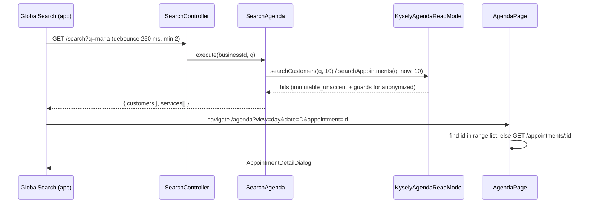

# Diseño: Sprint 2 - Panel del dueño para escritorio

## Enfoque técnico

El sprint agrega seis lecturas a la API (`GET /dashboard/summary`, `GET /search`, `GET /appointments/:id/free-technicians`, `GET /agenda/visible-hours`, `GET /agenda/to-close` y la búsqueda de clientes `GET /customers?search=` ampliada), corrige el nombre del cliente anonimizado en la vista de servicios (D17) y reorganiza la interfaz. No cambia ninguna escritura. Las lecturas nuevas viven en `api/src/scheduling` como casos de uso de solo lectura. Las reglas de negocio (qué cuenta como "hoy", quién trabaja, qué servicio está por cerrar, qué horas son visibles) quedan en funciones puras del dominio. SQL solo filtra, cuenta y ordena. La búsqueda sin acentos usa las extensiones `unaccent` y `pg_trgm` de Postgres, con una función envoltorio `IMMUTABLE` para poder indexar. En `app/` el layout pasa a depender del ancho: barra lateral desde 1024 px y barra inferior por debajo. La agenda de escritorio es una grilla única con un color por técnico. En móvil es una lista. Las convenciones del sprint 1 (D1 a D11 y D6.1) siguen vigentes: `snake_case` en cuerpos, `camelCase` en parámetros de consulta, `@ApiProblems`, contrato versionado y TDD estricto.

Nota de tamaño: este documento supera el presupuesto de 800 palabras del skill porque la fase debía resolver 13 decisiones explícitas. La numeración continúa la del sprint 1 (D12 en adelante).

## Hallazgos que corrigen o completan la propuesta

Estos puntos cambian el alcance técnico. Conviene que la spec los recoja.

1. **"Servicios pendientes" abarca varias fechas.** Un servicio `confirmed` sin cerrar de hace tres días también está pendiente. La lista de la agenda trabaja por día o por semana (`GET /appointments`, máximo 62 días), así que no puede mostrar todos los pendientes. Se agrega una sexta lectura, `GET /agenda/to-close`, que la propuesta y la spec `dashboard` ya incorporan (D16). "Servicios pendientes" cuenta solo `confirmed`; `pending` se decide en el sprint del bot.
2. **Hoy "servicio" ya significa "tipo de servicio" en la interfaz.** La barra inferior dice "Servicios" (`AppLayout.tsx`), `error-messages.ts` dice "Ya existe un servicio con ese nombre" (`service_name_taken`) y los diálogos usan la etiqueta "Servicio" para el tipo. Si "cita" pasa a "servicio" sin renombrar antes esos textos, ambos sentidos quedan mezclados. La migración renombra primero el sentido de catálogo (D20).
3. **Cliente anonimizado en las respuestas de citas.** `kysely-customer-directory.ts` guarda el alias también en `customers.name`, y `kysely-appointment-repository.ts` devuelve `c.name` sin mirar `anonymized_at`. Por eso `customerLabel(appointment.customer)` muestra `bear_1` en la agenda en lugar de "Cliente eliminado (bear_1)". Decisión del usuario: se corrige en este sprint. La consulta de vista (`viewQuery`) devuelve `customer.name = null` cuando `anonymized_at` no es nulo y el alias en `customer.alias`; las respuestas nuevas ya lo hacen (D13). El cambio y su compatibilidad están en D17; el riesgo R3 queda resuelto.
4. **"Técnicos activos X": definición de "trabaja hoy" (decisión del usuario).** Un técnico cuenta en X si le queda algún tramo de su turno de hoy después de restar sus días libres. Un día libre que cubre todo su turno de hoy lo saca de X, aunque no dure 24 horas (turno 08:00-17:00 con día libre 07:00-18:00, o exactamente 08:00-17:00). Un día libre que deja libre cualquier parte del turno (12:00-13:00) sigue contando. Un técnico sin disponibilidad semanal que cubra hoy no cuenta en X (D12).
5. **Postgres no tiene índice por fecha en `appointments`.** Solo existe el índice GiST de `appointments_no_overlap`. La agenda, el resumen y la búsqueda filtran por `business_id` y `starts_at`, así que la migración 005 agrega dos índices B-tree (D13).

## Decisiones de arquitectura

### D12. Resumen del Panel de control

`GET /dashboard/summary`, sin parámetros. Siempre se calcula para "ahora" en la zona del negocio.

| Opción | Ventaja | Costo | Decisión |
|---|---|---|---|
| A. Toda la lógica en SQL (agregados con `FILTER`, ventanas en SQL) | Una sola consulta | La regla de negocio y la zona horaria quedan en SQL, fuera del dominio y de `zoned-clock` | Rechazada |
| B. Cargar las filas de 30 días y contar en memoria | Todo en el dominio | Carga cientos o miles de filas para obtener cuatro números | Rechazada |
| C. Límites de tiempo y reglas en el dominio; SQL solo cuenta por estado en un rango de instantes | Las reglas son puras y se prueban; SQL no conoce reglas | Cuatro consultas pequeñas en lugar de una | **Elegida** |

Cálculo (caso de uso `GetDashboardSummary`, con `CLOCK`):

- `today = localDateOf(now, tz)`. `dayRange(today, tz)` da el rango de instantes del día, con horario de verano resuelto por `zoned-clock`.
- **Servicios hoy:** `countByStatus(dayRange(today))` y luego la función pura `servicesToday(counts)`, que suma todos los estados salvo `cancelled`.
- **Técnicos activos X/Y:** `listBookableTechnicians(businessId, dayRange(today))` devuelve los técnicos activos y no anonimizados (Y). X es la cantidad para la que `workingRangesOn(technician, today, tz)` no está vacío. Esa función pura convierte las franjas semanales del día ISO con `toInstant` y les resta los días libres. Resultado: sin disponibilidad hoy, el resultado es vacío y no cuenta; un día libre que cubre todo el turno (igual o mayor que él) lo deja vacío y lo saca de X; un día libre parcial deja algún tramo y sigue contando. Con varias franjas en el día, el técnico sale de X solo si los días libres cubren todas.
- **Eficiencia:** ventana `[dayRange(addDays(today, -29)).start, now)`, 30 días locales que incluyen hoy hasta este instante. `countByStatus(window)` y luego la función pura `efficiency(counts)`: `due` es la suma de `pending + confirmed + completed + no_show`, `completed` es la cantidad de completados y `rate` vale `completed / due`, o `null` si `due = 0`. La interfaz muestra "Sin datos" cuando `rate` es `null`; si no, el porcentaje redondeado al entero más cercano (por ejemplo 92 %). La fecha de corte visible sale de `efficiency.from` y se muestra como dd/mm/aaaa (25/09/2026 si hoy es 24/10/2026).
- **Servicios pendientes (decisión del usuario):** `countStartedBefore(now, TO_CLOSE_STATUSES)`, sin límite inferior de fecha, con `TO_CLOSE_STATUSES = ['confirmed']` en el dominio. Cuenta solo `confirmed` con inicio pasado y sin cerrar. `pending` queda fuera: lo crea solo el bot y su tratamiento se decide en el sprint del bot.
- **Servicios de hoy (lista):** `listViews(dayRange(today))` filtrado con `isOpen(status)` (`pending` y `confirmed`) y ordenado por inicio y luego por nombre del técnico. Incluye los que aún no empiezan y los ya empezados sin cerrar, y excluye cancelados y cerrados. Nota: esta lista usa `pending` + `confirmed` de hoy, mientras que "Servicios pendientes" usa solo `confirmed` de cualquier fecha; la diferencia es intencional y está registrada en la propuesta.

Rendimiento: con la migración 005, `ix_appointments_business_starts (business_id, starts_at)` sirve para el día y la ventana de 30 días, y el índice parcial `ix_appointments_open_starts (business_id, starts_at) WHERE status IN ('pending','confirmed')` sirve para los pendientes (el predicado `status = 'confirmed'` está contenido en el del índice) y para la lista de hoy. La respuesta incluye `today` para que la interfaz no calcule "hoy" con el reloj del navegador.

### D13. Búsqueda global y búsqueda de clientes sin acentos

`GET /search?q=` con `q` recortado de 2 a 100 caracteres. Fuera de ese rango responde `validation_error`.

| Opción | Ventaja | Costo | Decisión |
|---|---|---|---|
| A. `unaccent` + `pg_trgm` con una función `immutable_unaccent` e índices de expresión | Una sola normalización, la misma para columna y término; los datos no cambian | Requiere `CREATE EXTENSION` y conocer la regla de inmutabilidad | **Elegida** |
| B. Columna normalizada (`name_search`) escrita por la aplicación | No depende de extensiones | Cada escritura (crear, editar, anonimizar en tres módulos) debe mantenerla; necesita relleno de datos y la normalización de JS puede diferir de la del término | Rechazada |
| C. Normalizar solo en la consulta con `translate()` | Sin extensiones | Lista de caracteres a mano, incompleta, y sin índice | Rechazada |

- **Disponibilidad:** la imagen oficial `postgres:16-alpine` incluye los módulos `contrib`, entre ellos `unaccent` y `pg_trgm`. Docker Compose y Testcontainers usan la misma imagen (`api/test/support/postgres-container.ts`). Las dos extensiones son *trusted* desde Postgres 13: las puede crear el dueño de la base sin ser superusuario. La primera prueba de migración lo confirma, porque `globalSetup` aplica todas las migraciones.
- **Inmutabilidad:** `unaccent(text)` es `STABLE` porque depende de `search_path`, y Postgres no la acepta en un índice. La migración crea:

```sql
CREATE FUNCTION immutable_unaccent(text) RETURNS text
  LANGUAGE sql IMMUTABLE PARALLEL SAFE STRICT
  RETURN public.unaccent('public.unaccent'::regdictionary, $1);
```

  El cuerpo `RETURN` (Postgres 14+) se resuelve al crear la función y fija el diccionario de forma explícita. Por eso marcarla `IMMUTABLE` es seguro.
- **Migración `005_search_and_reads`:** `up` crea las extensiones `unaccent` y `pg_trgm`, la función, `ix_customers_name_search` (`GIN (lower(immutable_unaccent(name)) gin_trgm_ops)`) y los dos índices de `appointments` de D12. `down` los borra en orden inverso. No modifica datos.
- **Mecanismo compartido:** `api/src/database/text-search.ts` exporta `normalizedContains(column, term)`, un fragmento `sql<boolean>` con la forma `lower(immutable_unaccent(col)) LIKE '%' || lower(immutable_unaccent($term)) || '%'` (el término pasa antes por `escapeLike`, que se mueve a este archivo), y `phoneDigitsContain(column, term)`. `CustomersRepository.list` (`GET /customers?search=`) y el adaptador de búsqueda usan los dos. La regla del teléfono no cambia: si el término tiene algún dígito, se busca `phone LIKE '%dígitos%'`.
- **Grupo "Clientes"** (máximo 10): `anonymized_at IS NULL` y (nombre normalizado o dígitos del teléfono). Orden: `lower(immutable_unaccent(name))`, `id`. Respuesta: `id`, `name`, `phone`.
- **Grupo "Servicios"** (máximo 10, todas las fechas y todos los estados; los cancelados se incluyen y la interfaz muestra el estado "Cancelado", decisión del usuario). Coincide por cualquiera de estas condiciones:
  - nombre del cliente **solo si** `c.anonymized_at IS NULL`. Hace falta la guarda porque `customers.name` de un anonimizado contiene el alias.
  - `t.name` normalizado. Es `NULL` en un técnico eliminado, así que nunca coincide.
  - `a.service_name_snapshot` normalizado, el mismo nombre que muestra la agenda.
  
  Nunca se busca por alias ni por teléfono (ni el de un cliente ni el de un técnico). Orden (decisión del usuario), con este desempate:
  1. cercanía en días de calendario a hoy en la zona del negocio: `abs((a.starts_at AT TIME ZONE $tz)::date - $today::date)`;
  2. a igual cercanía, primero los no cancelados (`a.status = 'cancelled'` ascendente);
  3. `starts_at` ascendente;
  4. `id`.

  `today` y `tz` los calcula el caso de uso con `zoned-clock` y los pasa al puerto. El orden queda en SQL porque `LIMIT` debe aplicarse después de ordenar; el contrato del puerto lo documenta y las pruebas de integración lo cubren (ayer y mañana empatan en cercanía; un cancelado de hoy va después de un confirmado de hoy).
- **Privacidad en la respuesta:** cada servicio devuelve `customer` y `technician` como `{ id, name, alias }`, con `name: null` cuando la persona está anonimizada. No devuelve teléfono, dirección ni precio.
- **Índices:** el índice trigram de `customers` sirve a partir de 3 caracteres. Con 2 caracteres el planificador recorre la tabla del negocio, lo que es aceptable con el volumen esperado (miles de filas por negocio). `appointments` no lleva índice trigram en este sprint, porque las condiciones `OR` sobre tres tablas unidas no lo aprovecharían. Si un negocio supera unas 50.000 citas se mide de nuevo.

### D14. Técnicos libres para un servicio

`GET /appointments/{id}/free-technicians` devuelve `FreeTechnician[]` (`{ id, name }`) ordenado por antigüedad (`created_at`, `id`).

- El caso de uso `ListFreeTechnicians` usa `READ_PORTS`, sin bloqueo. Repite la lógica de `ReassignAppointment`: `findRecord`, `assertOpen(record.status, 'reasignar')`, `loadDaySchedule({ days: [localDateOf(startsAt)], excludeAppointmentId: id })` e `isTechnicianFree` para cada técnico reservable distinto del actual. La función que arma el `AppointmentFit` se extrae a `application/appointment-fit.ts` para que los dos casos de uso la compartan.
- Un servicio cerrado o cancelado responde `invalid_transition` (422), igual que reasignar. Un id inexistente responde `not_found`. No hay códigos de error nuevos.
- **Carrera:** la lista es una foto del momento. `POST /appointments/:id/reassign` sigue validando bajo el bloqueo del negocio y responde `slot_taken` si el elegido dejó de estar libre. Ante `slot_taken`, el diálogo invalida `['appointments', 'free-technicians', id]` y vuelve a cargar la lista.
- `ReassignDialog` reemplaza el filtro local de técnicos activos por `useFreeTechnicians(appointment.id)`. Con una lista vacía muestra "No hay técnicos libres en este horario" (el texto de la spec).

### D15. Horas visibles de la grilla

`GET /agenda/visible-hours?from=YYYY-MM-DD&to=YYYY-MM-DD&technicianIds=<uuid>&technicianIds=<uuid>` (rango de hasta 62 días y hasta 10 ids; `technicianIds` repetido, que es el formato por defecto de `openapi-fetch`). Respuesta: `{ days: [{ date, start_minute, end_minute }] }`, con los dos valores en `null` si ese día nadie trabaja.

- `GetVisibleHours` usa `listBookableTechnicians` (con los días libres de la ventana) filtrado por los ids pedidos. Los ids desconocidos o de técnicos no reservables se ignoran: no es un error. Para cada día, la función pura `visibleMinutesOn(technicians, day, tz)` toma `workingRangesOn` (la misma de D12) y devuelve el mínimo inicio y el máximo fin en minutos de pared desde la medianoche local, entre 0 y 1440. Para eso `zoned-clock.ts` agrega `minuteOfDay(instant, day, tz)` y Luxon sigue importándose solo desde ese archivo.
- Un día libre parcial recorta la franja: si cubre el inicio de la mañana, la hora visible empieza más tarde. Un día libre total deja el día en `null`.
- La disponibilidad es la vigente: para semanas pasadas se usan las franjas actuales. Los servicios de esas semanas igual quedan visibles gracias a la ampliación descrita abajo.
- **Ampliación en la interfaz:** `visibleHoursFor(appointments, days, tz, base)` recibe como `base` la unión de los días (mínimo inicio y máximo fin). Si todos los días son `null`, la base es 07:00-19:00, como ahora. Después sigue ampliando a horas en punto para que quepa todo servicio visible, buffer incluido. Así ningún servicio queda fuera de la vista (criterio de éxito).

### D16. Servicios por cerrar (lectura nueva)

`GET /agenda/to-close` devuelve `{ items: Appointment[], total: number }`: `items` son los servicios `confirmed` cuyo `starts_at` ya pasó, de cualquier fecha, ordenados por inicio ascendente (el más antiguo primero) con un máximo de 200, y `total` es la cantidad completa (mismo valor que la tarjeta). Cuando `total > 200` la lista muestra "Mostrando 200 de N". Esquema nuevo `ToCloseListSchema` y aserción en `openapi.spec.ts`; la ruta es nueva, así que no rompe a ningún cliente. Usa la misma regla (`TO_CLOSE_STATUSES`) que la tarjeta de D12, así lista y conteo coinciden. `pending` queda fuera hasta el sprint del bot. `QueryAppointments.listToClose(businessId)` usa el reloj y el método nuevo `AppointmentRepository.listConfirmedStartedBefore`. Pertenece a la capacidad `dashboard` (misma definición que la tarjeta); la lista que la muestra está en `owner-agenda-ui`. La tarjeta "Servicios pendientes" enlaza a `/agenda?display=list&toClose=1`. Con `toClose=1` la lista ignora la fecha, agrupa por día y muestra un chip "Por cerrar" que se puede quitar. Alternativa rechazada: limitar los pendientes a la ventana de 30 días. Así un servicio olvidado de hace 45 días desaparecería del contador sin aviso.

### D17. Módulos, contrato y errores

| Opción | Decisión |
|---|---|
| Módulo Nest nuevo (`dashboard`, `search`) | Rechazada: necesitaría el dominio de `scheduling` y sus puertos, y crearía dependencias cruzadas |
| Casos de uso de solo lectura dentro de `scheduling` | **Elegida** |

- **Puerto nuevo** `domain/ports/agenda-read-model.ts` (`AgendaReadModel`): `countByStatus(businessId, range)`, `countStartedBefore(businessId, instant, statuses)`, `searchCustomers(businessId, term, limit)` y `searchAppointments(businessId, term, now, limit)`. Adaptador: `infrastructure/persistence/kysely-agenda-read-model.ts`. Se inyecta con un token propio, `AGENDA_READ_MODEL`, y no se agrega a `SchedulingPorts`, para que los comandos no lo vean.
- **Controladores:** `DashboardController` (`/dashboard/summary`), `AgendaController` (`/agenda/visible-hours`, `/agenda/to-close`), `SearchController` (`/search`) y una ruta nueva en `AppointmentsController` (`GET :id/free-technicians`). Las rutas estáticas nuevas no se cuelgan de `/appointments` porque `GET /appointments/:id` usa `ParseUUIDPipe` y el orden de declaración sería frágil.
- **OpenAPI:** cada respuesta tiene su clase `*.schema.ts` (`DashboardSummarySchema`, `AppointmentSummarySchema`, `PartyRefSchema`, `SearchResultSchema`, `CustomerHitSchema`, `VisibleHoursSchema`, `FreeTechnicianSchema`, `ToCloseListSchema`), los errores van con `@ApiProblems` y se agrega una aserción de asignabilidad en `src/openapi/openapi.spec.ts`. Cada commit de la API corre `npm run openapi:export --prefix api` y `npm run gen:api --prefix app` y versiona `api/openapi.json` y `app/src/shared/api/schema.d.ts` juntos, para que `openapi:check` y `gen:api:check` pasen en cada commit.
- **Nombre del cliente anonimizado en la vista de servicios (R3 resuelto, decisión del usuario).** `AppointmentRepository.viewQuery` (`kysely-appointment-repository.ts`, usado por `GET /appointments`, `GET /appointments/:id`, las acciones y `GET /agenda/to-close`) hace `LEFT`/`INNER JOIN customers c` y selecciona hoy `c.name as customer_name`. Pasa a `CASE WHEN c.anonymized_at IS NULL THEN c.name END as customer_name` y mantiene `c.alias as customer_alias` (el alias ya viaja). Campos que cambian: solo el valor de `customer.name` en la respuesta, que es `null` si el cliente está anonimizado (antes devolvía el alias). Campos que no cambian: `customer.id`, `customer.alias`, `customer.phone` y todos los demás. El esquema `PartySchema` ya declara `name` como anulable ("Si fue anonimizado, `name` es nulo y se muestra `alias`"), así que el tipo TypeScript generado no cambia; se actualiza la descripción de `AppointmentCustomer` y se regeneran `api/openapi.json` y `app/src/shared/api/schema.d.ts` en el mismo commit (`openapi:check` y `gen:api:check` pasan). La compatibilidad es de intención: el cliente que ya usa `customerLabel` (`shared/lib/people.ts`, base de `customerRecordLabel`) formatea `name: null` + `alias` como "Cliente eliminado (alias)". En `customers.name` el alias se sigue guardando (no se toca la anonimización ni los datos), por eso las guardas de búsqueda por `anonymized_at` de D13 se mantienen. Se agrega una prueba de integración de la vista (cliente anonimizado: `name` null y `alias` presente; no anonimizado: sin cambios) y una de la interfaz (agenda, búsqueda y Panel muestran "Cliente eliminado (alias)"). Va en el commit 5 de D24. Antes de cerrarlo se revisa con una búsqueda de código que ningún otro consumidor de `Appointment.customer.name` suponga una cadena no nula.
- **Errores:** no hay códigos nuevos. Las rutas usan `validation_error`, `bad_request`, `not_found` e `invalid_transition`. `ERROR_MESSAGES` (`Record<ErrorCode, string>`) no cambia de forma; solo cambia su texto (D20).

### D18. Arquitectura de la interfaz

**Rutas.** Se conservan las rutas existentes, en inglés, para no romper enlaces ni pruebas.

| Ruta | Pantalla | Sección |
|---|---|---|
| `/` | `DashboardPage` (deja de redirigir a `/agenda`) | Panel de control |
| `/agenda` | `AgendaPage` | Agenda |
| `/customers`, `/customers/:id` | Clientes | Clientes |
| `/settings/technicians`, `/settings/technicians/:id` | Técnicos | Técnicos |
| `/settings/services` | Tipos de servicio | Tipos de servicio |
| `/settings/business` | Configuración | Configuración |
| `/profile` | `ProfilePage` (mock) | Perfil |

**Shell.** El cambio de layout se decide con JavaScript: `useIsDesktop()` en `shared/lib/use-media-query.ts`, basado en `matchMedia('(min-width: 1024px)')` con `useSyncExternalStore`. Se descartó resolverlo solo con CSS porque montaría las dos navegaciones y las dos agendas a la vez: duplica el DOM y en jsdom, que no aplica CSS, las pruebas encontrarían elementos repetidos. La contracción a íconos entre 1024 y 1279 px sí es solo CSS (`xl:`): la etiqueta pasa a `sr-only`, de modo que el nombre accesible se conserva.

- Escritorio: `Sidebar` oscura con Panel de control, Agenda, Clientes, Técnicos, Tipos de servicio y Configuración, y Perfil al pie.
- Móvil: `BottomNav` con 5 entradas de al menos 44 px de alto: "Panel" (`aria-label="Panel de control"`), "Agenda", "Clientes", "Técnicos" y "Más". "Más" abre un menú con "Tipos de servicio" y "Configuración". Perfil no aparece en la barra inferior: se abre desde un ícono en el encabezado del Panel.
- `PageHeader` (en `shared/ui`) muestra el título y, solo en móvil y fuera de `/`, un botón "Volver". Vuelve con `navigate(-1)` si hay historial dentro de la aplicación (`location.key !== 'default'`) y, si no, va a `/`.

**Enlace a un servicio.** `/agenda?view=day&date=YYYY-MM-DD&appointment=<uuid>` abre la ficha del servicio. Primero se busca en el rango cargado. Si no está, se pide con `useAppointment(id)`, que llama a `GET /appointments/:id` con la clave `['appointments', 'detail', id]`. `AppointmentFlows` recibe ese respaldo para la ficha y para las acciones que se abren desde ella. Si el día del servicio difiere de `date` (o falta), la página sustituye `date` por el día del servicio con `replace`. Si `GET /appointments/:id` responde `not_found`, la agenda muestra "No se encontró el servicio" y no abre ninguna ficha. Al cerrar el diálogo se quita el parámetro con `replace`. La ficha se abre aunque el técnico del servicio no esté entre los visibles. El Panel, la búsqueda y el diálogo de "cliente con servicios futuros" usan este enlace.

**Agenda en móvil (decisión del usuario):** por debajo de 1024 px la agenda muestra un solo día, con anterior, siguiente y "Hoy". No hay vista Semana en móvil: el selector Día/Semana solo existe en la grilla de escritorio. `parseAgendaParams` recibe `isDesktop` y en móvil fuerza `view = 'day'` aunque la URL diga `week`; anterior y siguiente avanzan un día.

**Parámetros de la agenda** (`agenda-params.ts`): `view` (solo escritorio), `date`, `display=list` (lista forzada en escritorio), `from` y `to` en `HH:MM` (franja de "+N más"), `toClose=1`, `cancelled=1`, y `technician`, `status` y `serviceType`, que pueden repetirse para los chips. Valores repetidos de una misma categoría se combinan con O; categorías distintas, con Y. Un `status=cancelled` en la URL muestra los cancelados aunque `cancelled=1` esté ausente. Todo vive en la URL, así que un enlace del Panel reproduce el filtro.

**Claves de TanStack Query.** Todo lo que depende de servicios cuelga de `['appointments', ...]` (`detail`, `to-close`, `summary`, `search`, `free-technicians`), así que el `invalidateQueries({ queryKey: ['appointments'] })` que ya hacen los comandos y los cambios de horario lo refresca sin cambios. Las horas visibles cuelgan de `['technicians', 'visible-hours', { from, to, ids }]`, que los cambios de horario ya invalidan.

**Selección de técnicos.** Se guarda en `localStorage['schedule-app.agenda.technicians']` como `{ "version": 1, "ids": [...] }`. La función pura `reconcileSelection(stored, technicians, max = 10)` descarta los ids desconocidos y los técnicos desactivados o eliminados que no tienen servicios en el rango visible (`reconcileSelection` recibe los ids con servicios en el rango). Un técnico recordado que se desactivó o eliminó pero sigue teniendo servicios en el rango se conserva en la selección, con su color y marcado como inactivo en el selector; sale de la selección cuando ya no tiene ninguno. Si la selección queda vacía, o la versión o el JSON no son válidos, usa los 10 técnicos activos más antiguos (el orden de `GET /technicians`, que ya viene por `created_at`). El selector lista los técnicos activos y, además, los inactivos o eliminados que tengan servicios en el rango, igual que hoy `toAgendaTechnicians`. Riesgo aceptado: la clave no incluye el negocio, porque hoy hay uno solo; con autenticación se agrega el id.

### D19. Grilla de escritorio

- **Modelo:** un eje de tiempo común. La vista Día tiene una columna; la vista Semana, que solo existe en escritorio, siete columnas de día con el mismo modelo. En cada columna, los servicios de los técnicos elegidos se reparten con `packOverlaps`, que no cambia porque ya es independiente del carril.
- **Desborde:** la función pura nueva `layoutDay(items, maxColumns)` en `agenda-layout.ts` devuelve `placed` y `overflow[]`. Cuando un grupo de solapes necesita más columnas que `maxColumns`, se muestran las primeras `maxColumns - 1` columnas. La última columna lleva un botón "+N más" que cubre el rango del grupo, con `fromMinute` y `toMinute` redondeados a la fila. El umbral es `maxColumns = 6` en la vista Día y `2` en la vista Semana, porque son las columnas que caben con un ancho mínimo de unos 140 px a 1280 px. El botón navega a `display=list&date=D&from=HH:MM&to=HH:MM`. La lista muestra un indicador de la franja ("10:00-11:30") con un enlace "Volver a la grilla" que quita `display`, `from` y `to`. Con `maxColumns` y N servicios simultáneos que no caben, se muestran `maxColumns - 1` tarjetas y el botón dice "+(N - (maxColumns - 1)) más".
- **Canceladas:** se ocultan por defecto también en la grilla, con el mismo interruptor `cancelled=1` que la lista.
- **Contrato de props (evoluciona el de D8):**

```ts
type AgendaGridProps = {
  view: 'day' | 'week';
  days: LocalDate[];
  timeZone: string;
  technicians: { id: string; name: string; initials: string; colorIndex: number }[]; // solo los elegidos
  appointments: AgendaAppointment[];              // ya filtrados a los técnicos elegidos
  visibleHours: VisibleHours;
  rowMinutes?: number;                            // 15 por defecto
  maxColumns?: number;                            // 6 en Día, 2 en Semana
  onAppointmentSelect(id: string): void;
  onOverflowSelect(day: LocalDate, fromMinute: number, toMinute: number): void;
  onEmptySlotSelect?(day: LocalDate): void;       // abre "Nuevo servicio" con ese día
};
```

  El filtro interno por técnico (`useState(ALL_TECHNICIANS)`) desaparece: la selección vive en la página.
- **Accesibilidad:** cada columna de día es un `section` con encabezado. Los servicios forman una `ul` en orden cronológico, de modo que el orden de tabulación sigue al tiempo aunque la posición visual sea absoluta. Cada servicio es un `button` con un nombre como "10:00 a 11:00, María Pérez, Instalación, técnico Juan Gómez, Confirmado". "+N más" tiene un nombre como "Ver 3 servicios más entre 10:00 y 11:30". El eje de horas lleva `aria-hidden`. La tarjeta muestra iniciales o nombre y una insignia de estado con ícono y texto.
- **Rendimiento:** el peor caso realista es 10 técnicos por 8 servicios por 7 días, unos 560 botones. `layoutDay` se memoriza por día con `useMemo`. No hace falta virtualizar.

### D20. Paleta de técnicos y tokens

- **Forma:** la tarjeta usa un fondo tenue del color del técnico, texto oscuro (en tema oscuro, fondo profundo y texto claro) y una franja izquierda de 4 px en el color de acento. El estado va en una insignia aparte con los tokens `--status-*`. Así el color del técnico no se confunde con el ámbar de `pending` ni con el azul de `confirmed`.
- **Tokens** en `index.css`, para `:root` y `.dark`: `--tech-1` a `--tech-10` (fondo), `--tech-N-foreground` (texto) y `--tech-N-accent` (franja), expuestos en `@theme inline`. Valores de partida (escala de Tailwind): tema claro con fondo 100, texto 900 y acento 600; tema oscuro con fondo 950, texto 100 y acento 400. Los tonos son blue, emerald, amber, rose, violet, cyan, orange, lime, fuchsia y stone. La prueba decide: si un tono no pasa, se ajusta un paso de la escala.
- **Prueba** (`tokens.test.ts`): en cada tema, texto sobre fondo con 4,5:1 o más, acento contra `--card` con 3:1 o más (contraste no textual, WCAG 1.4.11) y los 10 acentos distintos entre sí. Se agregan también los tokens de la barra lateral (`--sidebar`, `--sidebar-foreground`, `--sidebar-muted-foreground`, `--sidebar-accent`, `--sidebar-accent-foreground`) con sus pares AA.
- **Asignación** (`technician-colors.ts`, función pura): cada técnico prefiere el color `rangoPorAntigüedad mod 10`. El rango se calcula sobre todos los técnicos, eliminados incluidos (`includeAnonymized=true`). Como la fila de un técnico eliminado se conserva, borrar a uno no cambia los colores de los demás. Dentro de la selección visible, recorrida por antigüedad, si el color preferido ya está tomado se asigna el siguiente libre. Con 10 técnicos o menos los colores nunca cambian. Con más, solo cambian cuando hay un choque dentro de la selección.

### D21. Migración del vocabulario

1. **Primero el sentido de catálogo:** donde "servicio" significa tipo ("Servicios" en la navegación, "Servicio" en los formularios, `service_name_taken`, "servicio activo"), el texto pasa a "tipo de servicio" o "Tipos de servicio".
2. **Después "cita" pasa a "servicio",** ajustando la concordancia de género ("Cita creada." pasa a "Servicio creado.", "la cita" a "el servicio", "Nueva cita" a "Nuevo servicio"). Se hace archivo por archivo, no con un reemplazo ciego. Las pruebas cambian en el mismo commit.
3. **Alcance:** `app/src` (cerca de 400 apariciones fuera de `schema.d.ts`), `app/index.html` y `app/pwa.config.ts` (la descripción del manifiesto dice "Agenda de citas") y `app/README.md`. Los identificadores, rutas, claves de consulta, la API, sus textos `detail` y OpenAPI conservan `appointment` y "cita". La interfaz no muestra `detail`: traduce por `code`.
4. **Prueba de guarda** (`app/src/vocabulary.test.ts`): recorre `src/**/*.{ts,tsx}` sin pruebas ni `shared/api/schema.d.ts`, más `index.html` y `pwa.config.ts`. Usa la API del compilador de TypeScript (`typescript` ya es dependencia de desarrollo) y extrae solo `StringLiteral`, `NoSubstitutionTemplateLiteral`, las partes de plantillas y `JsxText`, así que comentarios e identificadores quedan fuera. Falla si encuentra `/\bcitas?\b/i` o voseo frecuente (`tenés`, `podés`, `querés`, `elegí`, `ingresá`, `escribí`, `confirmá`, `revisá`, `intentá`, `seleccioná`, `creá`, `guardá`, `cancelá`, `hacé`, `vos`). Las excepciones son una lista explícita `{ file, text, reason }`, vacía al empezar.

5. **Etiquetas de estado en masculino (decisión del usuario):** `app/src/features/agenda/appointment-status.ts` hoy dice Pendiente, Confirmada, Completada, No asistió, Cancelada (concuerdan con "cita"). El commit 6 las cambia a Pendiente, Confirmado, Completado, No asistió, Cancelado, junto con sus pruebas, para que concuerden con "servicio". La spec y este diseño usan las masculinas.

### D22. Perfil simulado

- **Archivos:** `app/src/features/profile/profile.mock.ts` (encabezado `MOCK: reemplazar en la fase de autenticación` y exporta `MOCK_PROFILE = { name: 'Dueño del negocio' }`) y `ProfilePage.tsx`.
- **Salvaguarda elegida:** `profile-mock.guard.test.ts` verifica que solo los archivos de `features/profile/` importan `profile.mock` y que el archivo conserva el marcador `MOCK`. Se descartó una bandera de compilación porque `npm run build` es parte de la verificación y debe pasar. Una bandera que nadie activa protegería tanto como un proceso manual. Hoy no existe un pipeline de despliegue: la garantía de no llegar a producción es la entrada en `debts.md` más la tarea de la fase de autenticación. Cuando exista un pipeline de publicación, se agrega allí una verificación que falle si el archivo existe.
- `openspec/changes/sprint-2-owner-panel/debts.md` registra el mock y la tarea "Reemplazar `profile.mock.ts` por el usuario autenticado".

### D23. Estrategia de pruebas

| Capa | Qué se prueba | Cómo | Extensiones |
|---|---|---|---|
| Dominio (unidad) | `workingRangesOn` (turno 08:00-17:00 con día libre 07:00-18:00 vacío, 12:00-13:00 con tramo restante, igual al turno vacío, sin disponibilidad hoy vacío; horario de verano en `America/New_York`), `visibleMinutesOn`, `servicesToday`, `efficiency` (con `due = 0`), `minuteOfDay`, `TO_CLOSE_STATUSES` (`pending` no cuenta) | Vitest, funciones puras, reloj fijo | No |
| Aplicación (unidad) | `GetDashboardSummary`, `ListFreeTechnicians` (servicio cerrado o cancelado, exclusión del propio bloque) y `GetVisibleHours` con puertos falsos | Vitest | No |
| Repositorio (integración) | Migración 005 `up` y `down`; "maria" encuentra "María" y "MARÍA"; `%` y `_` literales; el anonimizado no coincide por nombre ni por alias; técnico eliminado; orden por cercanía en días con cancelados al final a igual cercanía; `countByStatus` en el límite del día | Testcontainers | Sí |
| HTTP (integración) | Las 5 rutas nuevas (`/dashboard/summary`, `/search`, `/appointments/:id/free-technicians`, `/agenda/visible-hours`, `/agenda/to-close`) y `GET /customers?search=maria`: forma `snake_case`, `validation_error`, `not_found`, `invalid_transition`, privacidad de campos, y la vista de servicios con `customer.name` nulo para anonimizados | supertest | Sí (búsqueda) |
| Contrato | `openapi.spec.ts` (asignabilidad y archivo al día), `gen:api:check` | Vitest | No |
| App (RTL + MSW) | Shell por viewport, navegación móvil y "Volver", agenda móvil de un solo día sin Día/Semana, Panel (incluido "Sin datos"), lista y chips, `layoutDay` con 10 solapes, selector y `localStorage`, búsqueda, enlace a servicio, reasignación con lista libre y `slot_taken` | Vitest + jsdom; `src/test/viewport.ts` simula `matchMedia` en `setup.ts` y por defecto es móvil | No |
| Tokens y texto | Contraste AA de paleta y barra lateral, guarda de vocabulario y voseo, guarda del mock | Vitest | No |

Las pruebas actuales de `AgendaGrid` pasan a correr con viewport de escritorio. La prueba de aceptación del sprint 1 sigue igual.

### D24. Plan de commits por unidad de trabajo

El orden refina las unidades de la propuesta: 14 commits por unidad de trabajo, con los 5 de la API primero. Cada commit de la API regenera `openapi.json` y `schema.d.ts`.

| # | Commit | Depende de |
|---|---|---|
| 1 | `feat(api)`: migración 005 (extensiones, `immutable_unaccent`, índices), `text-search.ts`, `GET /customers?search=` sin acentos | - |
| 2 | `feat(api)`: `workingRangesOn`, `appointment-fit`, `GET /appointments/:id/free-technicians` | - |
| 3 | `feat(api)`: `visibleMinutesOn`, `minuteOfDay`, `GET /agenda/visible-hours` | 2 |
| 4 | `feat(api)`: `AgendaReadModel`, `GET /dashboard/summary`, `GET /agenda/to-close` | 1, 2 |
| 5 | `feat(api)`: `GET /search` y nombre de cliente anonimizado nulo en la vista de servicios (`viewQuery`, D17) | 1, 4 |
| 6 | `refactor(app)`: vocabulario "tipo de servicio" y luego "servicio", etiquetas de estado en masculino (`appointment-status.ts` y sus pruebas), guarda, `index.html`, manifiesto, README | - |
| 7 | `feat(app)`: tokens de técnicos y barra lateral, prueba AA, `technician-colors.ts` | - |
| 8 | `feat(app)`: `useIsDesktop`, `Sidebar`, `BottomNav` con "Más", `PageHeader` con "Volver", Perfil simulado, guarda y `debts.md` | 6, 7 |
| 9 | `feat(app)`: parámetros de la agenda y enlace a servicio con respaldo `GET /appointments/:id` | 8 |
| 10 | `feat(app)`: lista de la agenda, chips (O dentro de una categoría, Y entre categorías), "Por cerrar" (`/agenda/to-close`, aviso "Mostrando 200 de N") e interruptor de canceladas | 4, 9 |
| 11 | `feat(app)`: grilla única, `layoutDay` con "+N más", selector y su almacenamiento, horas visibles | 3, 7, 10 |
| 12 | `feat(app)`: Panel de control en `/`, entrada primera en las dos navegaciones | 4, 9, 10 |
| 13 | `feat(app)`: búsqueda global en la barra de la agenda | 5, 9 |
| 14 | `feat(app)`: reasignación con técnicos libres | 2 |

Cada commit incluye sus pruebas y la parte de `api/README.md` o `app/README.md` que le corresponde.

## Flujo de datos



```mermaid
sequenceDiagram
  participant D as ReassignDialog
  participant F as ListFreeTechnicians
  participant C as ReassignAppointment
  D->>F: GET /appointments/:id/free-technicians
  F-->>D: FreeTechnician[] (isTechnicianFree, own block excluded)
  D->>C: POST /appointments/:id/reassign {technician_id}
  alt chosen technician became busy
    C-->>D: 409 slot_taken
    D->>F: refetch free list
  else ok
    C-->>D: 200 Appointment; invalidate ['appointments']
  end
```

## Cambios de archivos

| Ruta | Acción | Descripción |
|---|---|---|
| `api/src/database/migrations/005_search_and_reads.ts`, `index.ts` | Crear / Modificar | Extensiones, función inmutable, índices |
| `api/src/database/text-search.ts` | Crear | `normalizedContains`, `phoneDigitsContain`, `escapeLike` |
| `api/src/modules/customers/customers.repository.ts` | Modificar | Búsqueda sin acentos |
| `api/src/scheduling/domain/services/{working-day,visible-hours,dashboard-kpis}.ts` | Crear | Reglas puras |
| `api/src/scheduling/domain/time/zoned-clock.ts` | Modificar | `minuteOfDay` |
| `api/src/scheduling/domain/ports/agenda-read-model.ts`, `appointment-repository.ts` | Crear / Modificar | Puerto de lectura y `listConfirmedStartedBefore` |
| `api/src/scheduling/application/{get-dashboard-summary,list-free-technicians,get-visible-hours,search-agenda,appointment-fit}.ts`, `query-appointments.ts`, `reassign-appointment.ts`, `tokens.ts` | Crear / Modificar | Casos de uso |
| `api/src/scheduling/infrastructure/persistence/kysely-agenda-read-model.ts`, `kysely-appointment-repository.ts` | Crear / Modificar | Adaptadores |
| `api/src/scheduling/infrastructure/http/{dashboard,agenda,search}.controller.ts`, `appointments.controller.ts`, `dto/*` | Crear / Modificar | Rutas, DTO y esquemas |
| `api/src/scheduling/scheduling.module.ts`, `api/src/openapi/openapi.spec.ts`, `api/openapi.json`, `api/README.md` | Modificar | Cableado y contrato |
| `app/src/app/{AppLayout,Sidebar,BottomNav,nav-items,routes}.tsx` | Crear / Modificar | Shell adaptable |
| `app/src/shared/lib/use-media-query.ts`, `app/src/shared/ui/PageHeader.tsx`, `app/src/test/viewport.ts`, `setup.ts` | Crear / Modificar | Viewport y "Volver" |
| `app/src/features/dashboard/*` | Crear | Panel de control |
| `app/src/features/profile/*` | Crear | Perfil simulado y guarda |
| `app/src/features/agenda/{AgendaList,AgendaFilters,TechnicianSelector,GlobalSearch}.tsx`, `{agenda-list,technician-selection,technician-colors,search-api,visible-hours-api}.ts` | Crear | Lista, selector, colores, búsqueda |
| `app/src/features/agenda/{AgendaPage,AgendaGrid}.tsx`, `{agenda-layout,agenda-params,agenda-api}.ts` | Modificar | Grilla única, parámetros, consultas |
| `app/src/features/appointments/{AppointmentFlows,ReassignDialog}.tsx`, `appointments-api.ts` | Modificar | Enlace a servicio y técnicos libres |
| `app/src/index.css`, `app/src/theme/tokens.test.ts`, `app/src/vocabulary.test.ts` | Modificar / Crear | Tokens y guardas |
| `app/index.html`, `app/pwa.config.ts`, `app/README.md`, demás textos de `app/src` | Modificar | Vocabulario |
| `app/src/shared/api/schema.d.ts` | Regenerar | Nunca a mano |
| `openspec/changes/sprint-2-owner-panel/debts.md` | Crear | Mock de Perfil |

## Interfaces y contratos

```ts
type PartyRef = { id: string; name: string | null; alias: string | null }; // name null if anonymized
type AppointmentSummary = {
  id: string; status: AppointmentStatus; starts_at: string; ends_at: string;
  service_name: string; customer: PartyRef; technician: PartyRef;
};
type DashboardSummary = {
  today: string; generated_at: string;
  services_today: number;
  technicians_working_today: number; technicians_active: number;
  efficiency: { from: string; to: string; completed: number; due: number; rate: number | null };
  to_close: number;
  remaining_today: AppointmentSummary[];
};
type SearchResult = { customers: { id: string; name: string; phone: string }[]; services: AppointmentSummary[] };
type VisibleHours = { days: { date: string; start_minute: number | null; end_minute: number | null }[] };
type FreeTechnician = { id: string; name: string };
type ToCloseList = { items: Appointment[]; total: number }; // GET /agenda/to-close; items: existing Appointment schema, max 200, oldest first
```

## Migración y despliegue

La migración 005 es aditiva: dos extensiones, una función y tres índices, sin cambios de datos. `down` la revierte por completo (`npm run db:rollback --prefix api`). En un Postgres administrado, quien ejecute las migraciones necesita permiso `CREATE` sobre la base para crear extensiones *trusted*. Cada commit se puede revertir por separado. La selección de técnicos en `localStorage` está versionada; si cambia su forma, una versión desconocida vuelve al valor por defecto.

## Riesgos

| # | Riesgo | Referencia | Mitigación |
|---|---|---|---|
| R1 | Choque entre "servicio" (catálogo) y "servicio" (cita) | `AppLayout.tsx`, `error-messages.ts` | Orden de dos pasos de D21 |
| R2 | Pendientes de días anteriores invisibles en una lista diaria | `agenda-params.ts`, D16 | `GET /agenda/to-close` |
| R3 | Las respuestas `Appointment` muestran el alias como nombre del cliente anonimizado | `kysely-customer-directory.ts:57`, `kysely-appointment-repository.ts:307` | **Resuelto en este sprint (decisión del usuario).** `viewQuery` usa `CASE WHEN c.anonymized_at IS NULL THEN c.name END` en el commit 5 y la interfaz formatea "Cliente eliminado (alias)" con `customerLabel` (D17). El esquema ya admitía `name: null`, así que el tipo generado no cambia |
| R4 | `unaccent` no es inmutable | Postgres | `immutable_unaccent` con diccionario explícito |
| R5 | Postgres administrado sin permiso para extensiones | Migración 005 | Extensiones *trusted*; documentar en `api/README.md` |
| R6 | jsdom no implementa `matchMedia` | `app/src/test/setup.ts` | Simulación en `viewport.ts`; pruebas de grilla con escritorio explícito |
| R7 | La ficha solo se resuelve con el rango cargado | `AppointmentFlows.tsx:84` | Respaldo con `GET /appointments/:id` |
| R8 | Rutas estáticas bajo `/appointments` chocan con `:id` | `appointments.controller.ts:60` | Rutas nuevas bajo `/agenda`, `/dashboard` y `/search` |
| R9 | Sin índice por fecha en `appointments` | `003_appointments.ts` | Índices de la migración 005 |
| R10 | Colores repetidos con más de 10 técnicos | D20 | Reasignación dentro de la selección visible |
| R11 | "Servicios pendientes" (solo `confirmed`) y "Servicios de hoy" (`pending` + `confirmed` de hoy) usan conjuntos de estados distintos | D12, D16 | Intencional (decisión del usuario): `pending` se decide en el sprint del bot. Cuando exista, se revisa si la tarjeta lo incluye |
| R12 | Una URL con `view=week` abierta en móvil | D18 | En móvil se fuerza `day`; prueba de `agenda-params` |

## Estimación de carga de revisión (Review Workload Forecast)

- Líneas cambiadas estimadas: **6.500-8.500** (sin lockfiles ni archivos generados). Sube respecto de la propuesta (5.500-7.500) por la lectura `to-close`, el puerto de lectura y el vocabulario, que cambia cerca de 900 líneas entre código y pruebas.
- 14 commits por unidad de trabajo (D24), con los 5 de la API primero.
- Aproximado por bloque: API, unas 2.200 (commits 1-5); vocabulario, unas 900; shell, Perfil y parámetros, unas 1.000; lista y grilla, unas 2.000; Panel, búsqueda y reasignación, unas 1.300.
- Estrategia de entrega: `exception-ok`, con commits por unidad de trabajo (D24).
- Decision needed before apply: No
- Chained PRs recommended: No
- 400-line budget risk: High

## Preguntas abiertas

Ninguna. Todas las preguntas quedaron resueltas con el usuario (etiquetas en masculino en D21, tope de la lista por cerrar en D16, selector en D18, chips en D18, ventana de eficiencia en D12).
